<picture>
  <source media="(prefers-color-scheme: dark)" srcset="docs/assets/cover-dark.svg">
  
</picture>

**Cyclorama Dawn (`LX 263 Dark` / `LX 512 Light`)** themes and application ports for **20 everyday apps** (**60 verified variants** across `Cyclorama Dawn`, `Cyclorama Steel`, and `Cyclorama Day`), compiled from [`Real-Fruit-Snacks/rfs-brand`](https://github.com/Real-Fruit-Snacks/rfs-brand) (`v2.1.0`).

Browse live previews, filter by category, copy snippets, and download configs at **[real-fruit-snacks.github.io/rfs-themes](https://real-fruit-snacks.github.io/rfs-themes/)**.

## Three Standard Variants

| Variant | Lighting Cue | Mode | Role |
|---|---|---|---|
| **Cyclorama Dawn** | `LX 263` | Dark (`#050507`) | Beacon Orange (`#FF9254`) primary focus, Steel Blue (`#74B8E8`) secondary |
| **Cyclorama Steel** | `LX 263` | Dark (`#050507`) | Steel Blue (`#74B8E8`) primary focus, Beacon Orange (`#FF9254`) secondary |
| **Cyclorama Day** | `LX 512` | Light (`#F5F7F9`) | Alabaster Day light workspace, burnt Beacon (`#AD3D0A`) & Steel (`#164669`) |

## Application Ports (20 Apps · 60 Variants)

### Editors & IDEs (4)

| App | Format | Install Summary | Port |
|---|---|---|---|
| **VS Code** | VS Code JSON Theme Extension | Copy `apps/vscode/` into `~/.vscode/extensions/rfs-cyclorama-dawn` and pick Color Theme | [`apps/vscode/`](apps/vscode/) |
| **Neovim** | Lua Colorscheme Plugin | Add `apps/neovim/` to your plugin manager and run `:colorscheme cyclorama-dawn` | [`apps/neovim/`](apps/neovim/) |
| **Zed** | Zed JSON Theme (v0.2.0) | Copy `themes/cyclorama.json` into `~/.config/zed/themes/` and select a variant | [`apps/zed/`](apps/zed/) |
| **JetBrains IDEs** | IntelliJ `.icls` + `.theme.json` | Import `.icls` under Settings → Editor → Color Scheme or load UI theme plugin | [`apps/jetbrains/`](apps/jetbrains/) |

### Terminals (5)

| App | Format | Install Summary | Port |
|---|---|---|---|
| **Windows Terminal** | JSON Schemes + PSReadLine `.ps1` | Paste scheme into `settings.json` `"schemes"` array + dot-source PSReadLine `.ps1` | [`apps/windows-terminal/`](apps/windows-terminal/) |
| **WezTerm** | TOML Color Scheme + Lua Snippet | Copy `.toml` into `~/.config/wezterm/colors/` and set `config.color_scheme` | [`apps/wezterm/`](apps/wezterm/) |
| **Alacritty** | TOML Theme (`v0.13+`) | Import `cyclorama-*.toml` via `general.import` in `alacritty.toml` | [`apps/alacritty/`](apps/alacritty/) |
| **Ghostty** | Ghostty `key = value` Theme | Copy theme file to `~/.config/ghostty/themes/` and set `theme = cyclorama-dawn` | [`apps/ghostty/`](apps/ghostty/) |
| **Kitty** | Kitty `.conf` Theme | Include `cyclorama-*.conf` in `kitty.conf` or run `kitty +kitten themes` | [`apps/kitty/`](apps/kitty/) |

### CLI & TUI (5)

| App | Format | Install Summary | Port |
|---|---|---|---|
| **Starship** | Starship `.toml` Palette | Copy `cyclorama-dawn.toml` to `~/.config/starship.toml` or include `palettes.toml` | [`apps/starship/`](apps/starship/) |
| **Oh My Posh** | Oh My Posh `.omp.json` | Pass `--config apps/oh-my-posh/cyclorama-dawn.omp.json` to `oh-my-posh init` | [`apps/oh-my-posh/`](apps/oh-my-posh/) |
| **bat** | TextMate `.tmTheme` XML | Copy `.tmTheme` files into `$(bat --config-dir)/themes` and run `bat cache --build` | [`apps/bat/`](apps/bat/) |
| **git-delta** | Git Config `[delta]` Feature | Include `cyclorama-*.gitconfig` in `~/.gitconfig` and enable `features` | [`apps/delta/`](apps/delta/) |
| **fzf** | Shell / PowerShell `FZF_DEFAULT_OPTS` | Source `cyclorama-dawn.sh` (Bash/Zsh) or `cyclorama-dawn.ps1` (PowerShell) | [`apps/fzf/`](apps/fzf/) |

### Notes & Writing (2)

| App | Format | Install Summary | Port |
|---|---|---|---|
| **PrivacyNotes** | `pn1:` theme code | Settings → Design → Paste theme code (all 17/17 contrast checks passing) | [`apps/privacynotes/`](apps/privacynotes/) |
| **Obsidian** | Obsidian Theme (`manifest.json` + `theme.css`) | Copy into `.obsidian/themes/Cyclorama Dawn/` or enable CSS snippets | [`apps/obsidian/`](apps/obsidian/) |

### Browsers & Desktop (4)

| App | Format | Install Summary | Port |
|---|---|---|---|
| **Brave / Chrome / Edge** | Chromium MV3 Browser Theme | Extensions → Developer mode → Load unpacked variant folder | [`apps/chromium/`](apps/chromium/) |
| **Discord (Vencord / BetterDiscord)** | `.theme.css` Client Theme | Drop `cyclorama-*.theme.css` into your Vencord / BetterDiscord `themes/` folder | [`apps/discord/`](apps/discord/) |
| **qBittorrent** | QSS Stylesheet + `config.json` | Package `.qbtheme` or point Behavior → Custom UI Theme to a variant folder | [`apps/qbittorrent/`](apps/qbittorrent/) |
| **Flow Launcher** | WPF XAML ResourceDictionary | Copy `Cyclorama *.xaml` into `%APPDATA%\FlowLauncher\Themes\` | [`apps/flow-launcher/`](apps/flow-launcher/) |

## Repository Layout

| Path | What it holds |
|---|---|
| `apps/<slug>/` | Self-contained theme port for each application (`themes.json`, native configs/codes, `previews/`, `README.md`) |
| `apps/manifest.json` | Machine-readable registry of all 20 supported apps and 60 variants |
| `brand/rfs.tokens.json` | Canonical Cyclorama Dawn tokens synced from `rfs-brand` `v2.1.0` |
| `tools/` | Zero-dependency Python palette engine, SVG preview renderers, master orchestrator, and CI validator |
| `docs/` | Interactive Cyclorama Dawn 20-app theme gallery published via GitHub Pages (`docs/assets/catalog.json`) |

## Build & Verify Locally

```sh
python tools/build_all.py
python tools/verify-themes.py
```

See [`AGENTS.md`](AGENTS.md) for the contributor and automation contract when adding or updating an application port.
