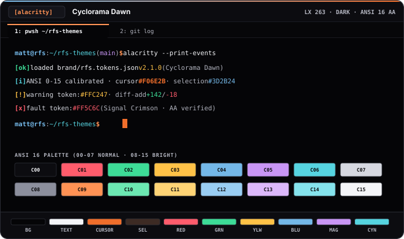
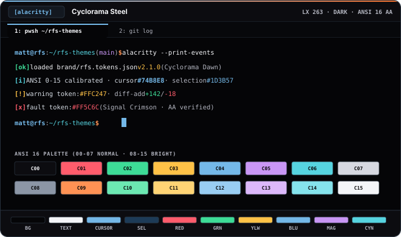
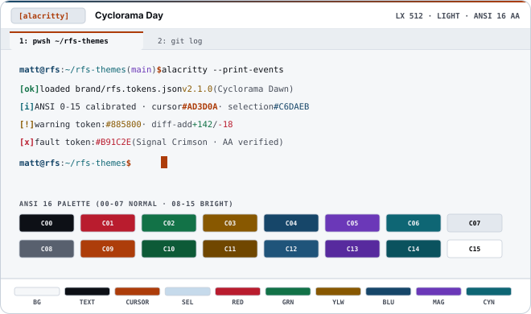

# Cyclorama Dawn for Alacritty

Three **Cyclorama Dawn v2.3.2 (Steel & Beacon Orange)** TOML themes for **[Alacritty](https://alacritty.org/)** (v0.13+), calibrated from [`Real-Fruit-Snacks/rfs-brand`](https://github.com/Real-Fruit-Snacks/rfs-brand).

## Variants

| Variant | Lighting | Mode | Accent Role | Theme File |
|---|---|---|---|---|
| **Cyclorama Dawn** | `LX 263` | `dark` | Beacon Orange | [`cyclorama-dawn.toml`](cyclorama-dawn.toml) |
| **Cyclorama Steel** | `LX 263` | `dark` | Steel Blue | [`cyclorama-steel.toml`](cyclorama-steel.toml) |
| **Cyclorama Day** | `LX 512` | `light` | Alabaster Day | [`cyclorama-day.toml`](cyclorama-day.toml) |

## Install

1. Copy the desired `.toml` file into `~/.config/alacritty/themes/` (on Windows: `%APPDATA%\alacritty\themes\`).
2. Import it in `alacritty.toml`:

```toml
[general]
import = ["~/.config/alacritty/themes/cyclorama-dawn.toml"]
```

## Previews

### 1. Cyclorama Dawn (`LX 263 Dark · Beacon Orange`)

Matte #050507 dark stage with Beacon Orange focus and Steel Blue secondary accents.



### 2. Cyclorama Steel (`LX 263 Dark · Steel Blue`)

Cool steel-charcoal dark stage with Steel Blue controls and Beacon Orange highlights.



### 3. Cyclorama Day (`LX 512 Light · Alabaster Day`)

Crisp #F5F7F9 Alabaster Day light workspace with white panels, burnt Beacon links, and Steel buttons.



## Palette Mapping

| Role | Cyclorama Dawn (`LX 263`) | Cyclorama Steel (`LX 263`) | Cyclorama Day (`LX 512`) |
|---|---|---|---|
| Background / Foreground | `#050507` / `#F4F5F8` | `#050507` / `#F4F5F8` | `#F5F7F9` / `#0D1016` |
| Cursor / Cursor Text | `#F06E2B` / `#050507` | `#74B8E8` / `#050507` | `#AD3D0A` / `#FFFFFF` |
| Selection Background | `#3D2B24` | `#1D3B57` | `#C6DAEB` |
| Accent / Secondary | `#FF9254` / `#74B8E8` | `#74B8E8` / `#FF9254` | `#AD3D0A` / `#164669` |
| ANSI Red / Green / Yellow | `#FF5C6C` / `#3DDC97` / `#FFC247` | `#FF5C6C` / `#3DDC97` / `#FFC247` | `#B91C2E` / `#127247` / `#885800` |
| ANSI Blue / Magenta / Cyan | `#74B8E8` / `#C996F5` / `#56D4E0` | `#74B8E8` / `#C996F5` / `#56D4E0` | `#164669` / `#6B38B8` / `#0E6674` |

## Regenerating

```sh
python tools/build_terminals.py
```
