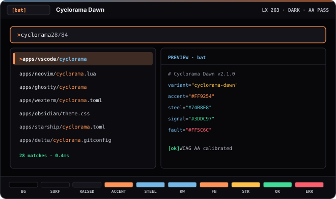
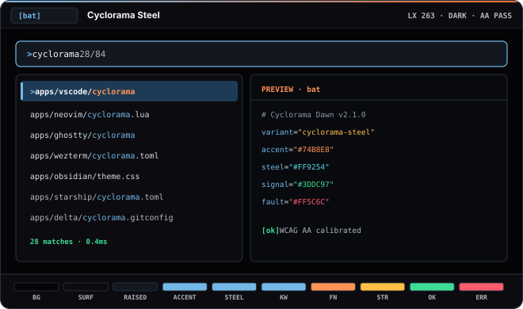
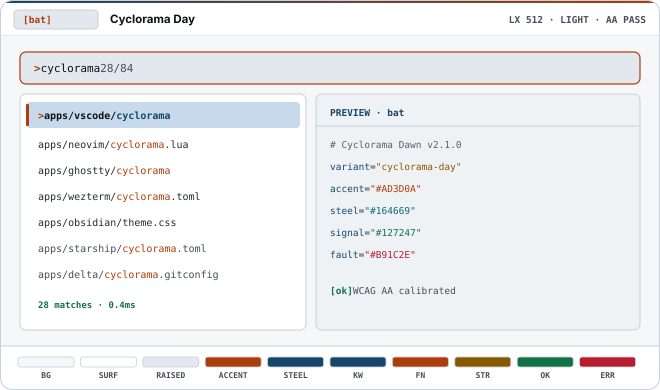

# Cyclorama Dawn for bat

Three **Cyclorama Dawn v2.3.2 (Steel & Beacon Orange)** themes for **[bat](https://github.com/sharkdp/bat)**, built from [`Real-Fruit-Snacks/rfs-brand`](https://github.com/Real-Fruit-Snacks/rfs-brand) tokens in [`Real-Fruit-Snacks/rfs-themes`](https://github.com/Real-Fruit-Snacks/rfs-themes). These `.tmTheme` files also power `syntax-theme` in [`git-delta`](../delta/README.md) once installed in bat's cache.

## Install

1. Copy `Cyclorama Dawn.tmTheme`, `Cyclorama Steel.tmTheme`, and `Cyclorama Day.tmTheme` into `"$(bat --config-dir)/themes/"`.
2. Rebuild bat's syntax theme cache with `bat cache --build`.
3. Select your variant with `bat --theme="Cyclorama Dawn"` (or add `--theme="Cyclorama Dawn"` to `$(bat --config-file)`).

```sh
mkdir -p "$(bat --config-dir)/themes"
cp apps/bat/*.tmTheme "$(bat --config-dir)/themes/"
bat cache --build
bat --theme="Cyclorama Dawn" README.md
```

## Variants

| Variant | Lighting Cue | Mode | Accent Role | Background | Accent | Secondary | Files |
|---|---|---|---|---|---|---|---|
| **Cyclorama Dawn** | `LX 263` | Dark | Beacon Orange | `#050507` | `#FF9254` | `#74B8E8` | [`Cyclorama Dawn.tmTheme`](Cyclorama%20Dawn.tmTheme) |
| **Cyclorama Steel** | `LX 263` | Dark | Steel Blue | `#050507` | `#74B8E8` | `#FF9254` | [`Cyclorama Steel.tmTheme`](Cyclorama%20Steel.tmTheme) |
| **Cyclorama Day** | `LX 512` | Light | Alabaster Day | `#F5F7F9` | `#AD3D0A` | `#164669` | [`Cyclorama Day.tmTheme`](Cyclorama%20Day.tmTheme) |

### 1. Cyclorama Dawn (`LX 263 Dark · Beacon Orange`)

TextMate .tmTheme dark syntax palette on #050507 with Beacon Orange functions, Steel keywords, and Signal numbers.



### 2. Cyclorama Steel (`LX 263 Dark · Steel Blue`)

TextMate .tmTheme steel-charcoal dark syntax palette paired with Steel Blue focus and crisp diff scopes.



### 3. Cyclorama Day (`LX 512 Light · Alabaster Day`)

TextMate .tmTheme Alabaster Day light syntax palette tuned for bright terminals and WCAG AA readability.



## Regenerating

```sh
python tools/build_cli.py
```
