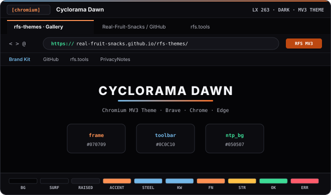
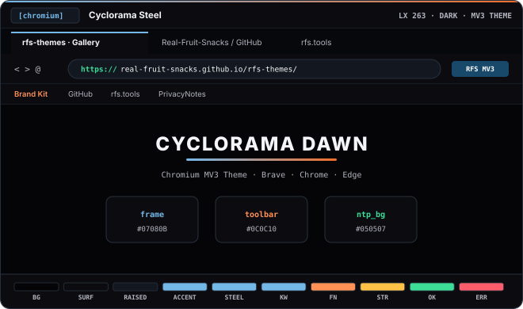
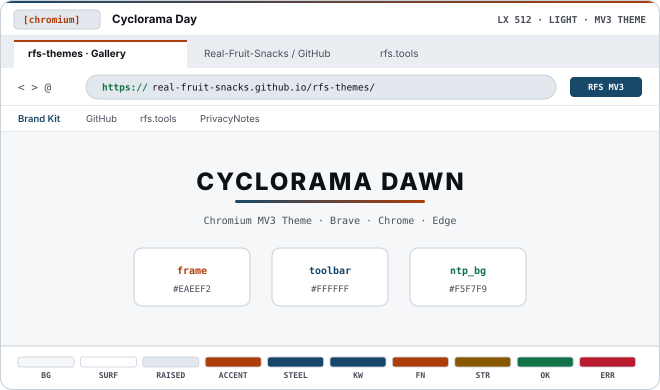

# Cyclorama Dawn for Brave / Chrome / Edge

Three unpacked Manifest V3 browser themes for Chromium-based browsers (Brave, Chrome, Edge, Vivaldi). Calibrated from [`brand/rfs.tokens.json`](../../brand/rfs.tokens.json) (**Cyclorama Dawn v2.1.0**) for **[Brave / Chrome / Edge](https://brave.com/)** (`Chromium MV3 Browser Theme`).

## Install

1. Open `brave://extensions`, `chrome://extensions`, or `edge://extensions` and enable **Developer mode**.
2. Click **Load unpacked** and select `apps/chromium/cyclorama-dawn` (or `cyclorama-steel` / `cyclorama-day`).
3. Switch variants anytime by loading another folder or clicking **Reset to default** in Appearance settings.

## Included Files

| Artifact | Path |
|---|---|
| Cyclorama Dawn MV3 Manifest | [`cyclorama-dawn/manifest.json`](cyclorama-dawn/manifest.json) |
| Cyclorama Steel MV3 Manifest | [`cyclorama-steel/manifest.json`](cyclorama-steel/manifest.json) |
| Cyclorama Day MV3 Manifest | [`cyclorama-day/manifest.json`](cyclorama-day/manifest.json) |

## Variants

| Variant | Lighting Cue | Mode | Primary Accent | Background | Surface | Accent | Secondary |
|---|---|---|---|---|---|---|---|
| **Cyclorama Dawn** | `LX 263` | dark | Beacon Orange | `#050507` | `#0C0C10` | `#FF9254` | `#74B8E8` |
| **Cyclorama Steel** | `LX 263` | dark | Steel Blue | `#050507` | `#0C0C10` | `#74B8E8` | `#FF9254` |
| **Cyclorama Day** | `LX 512` | light | Alabaster Day | `#F5F7F9` | `#FFFFFF` | `#AD3D0A` | `#164669` |

### 1. Cyclorama Dawn (`LX 263 · Beacon Orange`)

Matte #050507 New Tab canvas, #070709 tab strip, #0C0C10 toolbar, and Beacon Orange NTP links & button tint.



### 2. Cyclorama Steel (`LX 263 · Steel Blue`)

Cool steel-charcoal browser chrome with #131820 omnibox and Steel Blue NTP links & button tint.



### 3. Cyclorama Day (`LX 512 · Alabaster Day`)

Crisp #F5F7F9 Alabaster Day light browser chrome with white toolbar, soft rail frame, and burnt Beacon links.



## Regenerating

```sh
python tools/build_desktop.py
```

Browse all ports in the [Cyclorama Dawn Theme Gallery](https://real-fruit-snacks.github.io/rfs-themes/) or on [GitHub](https://github.com/Real-Fruit-Snacks/rfs-themes).
