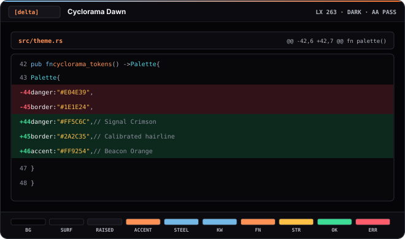
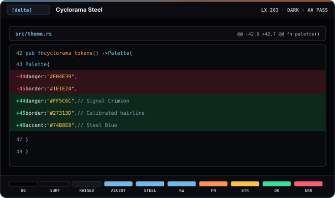
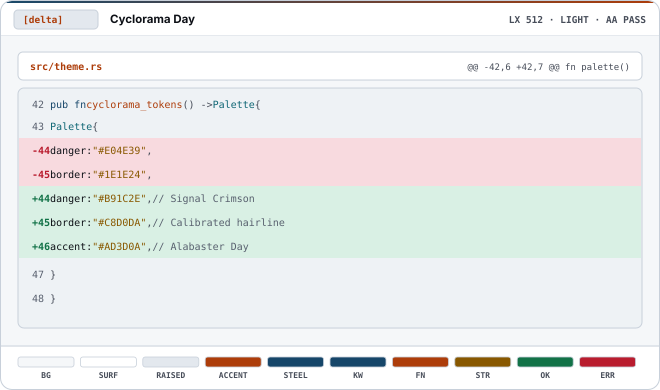

# Cyclorama Dawn for git-delta

Three **Cyclorama Dawn v2.1.0 (Steel & Beacon Orange)** themes for **[git-delta](https://dandavison.github.io/delta/)**, built from [`Real-Fruit-Snacks/rfs-brand`](https://github.com/Real-Fruit-Snacks/rfs-brand) tokens in [`Real-Fruit-Snacks/rfs-themes`](https://github.com/Real-Fruit-Snacks/rfs-themes). Pair with [`apps/bat/`](../bat/README.md) so `syntax-theme` uses the matching Cyclorama Dawn TextMate grammar.

## Install

1. Add `[include]` with `path = /path/to/rfs-themes/apps/delta/cyclorama.gitconfig` to your `~/.gitconfig`.
2. Set `features = cyclorama-dawn` (or `cyclorama-steel` / `cyclorama-day`) under `[delta]`.
3. Install the matching `.tmTheme` files from `apps/bat/` and run `bat cache --build` so `syntax-theme` resolves cleanly.

```gitconfig
[include]
    path = /path/to/rfs-themes/apps/delta/cyclorama.gitconfig

[core]
    pager = delta

[delta]
    features = cyclorama-dawn
```

## Included Pack Files

- [cyclorama.gitconfig — Unified pack with all 3 named features](cyclorama.gitconfig)

## Variants

| Variant | Lighting Cue | Mode | Accent Role | Background | Accent | Secondary | Files |
|---|---|---|---|---|---|---|---|
| **Cyclorama Dawn** | `LX 263` | Dark | Beacon Orange | `#050507` | `#FF9254` | `#74B8E8` | [`cyclorama-dawn.gitconfig`](cyclorama-dawn.gitconfig) |
| **Cyclorama Steel** | `LX 263` | Dark | Steel Blue | `#050507` | `#74B8E8` | `#FF9254` | [`cyclorama-steel.gitconfig`](cyclorama-steel.gitconfig) |
| **Cyclorama Day** | `LX 512` | Light | Alabaster Day | `#F5F7F9` | `#AD3D0A` | `#164669` | [`cyclorama-day.gitconfig`](cyclorama-day.gitconfig) |

### 1. Cyclorama Dawn (`LX 263 Dark · Beacon Orange`)

Dark git-delta diff palette with Signal Emerald additions, Signal Crimson deletions, and Beacon Orange file headers.



### 2. Cyclorama Steel (`LX 263 Dark · Steel Blue`)

Steel-charcoal dark git-delta diff palette with Steel Blue headers and calibrated blame/hunk framing.



### 3. Cyclorama Day (`LX 512 Light · Alabaster Day`)

Alabaster Day light git-delta diff palette with crisp pastel diff washes and WCAG AA line-number markers.



## Regenerating

```sh
python tools/build_cli.py
```
