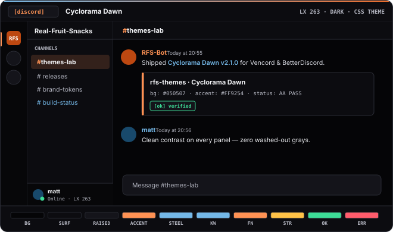
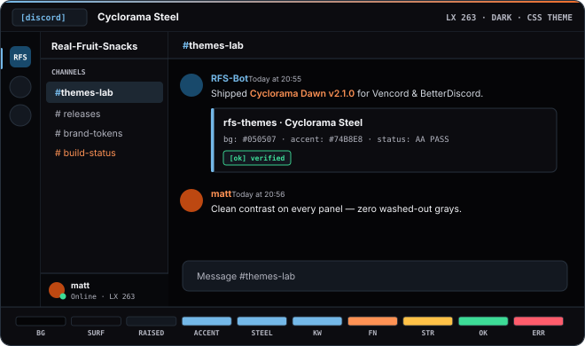
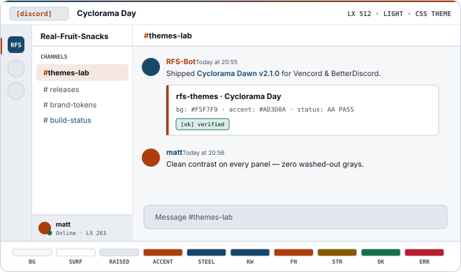

# Cyclorama Dawn for Discord (Vencord / BetterDiscord)

Three drop-in `.theme.css` files compatible with Vencord and BetterDiscord. Calibrated from [`brand/rfs.tokens.json`](../../brand/rfs.tokens.json) (**Cyclorama Dawn v2.3.2**) for **[Discord (Vencord / BetterDiscord)](https://vencord.dev/)** (`Vencord / BetterDiscord .theme.css`).

## Install

1. Open Discord -> Settings -> **Themes** (Vencord or BetterDiscord) -> **Open Themes Folder**.
2. Copy `cyclorama-dawn.theme.css`, `cyclorama-steel.theme.css`, or `cyclorama-day.theme.css` into the folder.
3. Enable the theme in Settings -> Themes (match Discord Appearance to Dark for Dawn/Steel, Light for Day).

## Included Files

| Artifact | Path |
|---|---|
| Cyclorama Dawn Theme CSS | [`cyclorama-dawn.theme.css`](cyclorama-dawn.theme.css) |
| Cyclorama Steel Theme CSS | [`cyclorama-steel.theme.css`](cyclorama-steel.theme.css) |
| Cyclorama Day Theme CSS | [`cyclorama-day.theme.css`](cyclorama-day.theme.css) |

## Variants

| Variant | Lighting Cue | Mode | Primary Accent | Background | Surface | Accent | Secondary |
|---|---|---|---|---|---|---|---|
| **Cyclorama Dawn** | `LX 263` | dark | Beacon Orange | `#050507` | `#0C0C10` | `#FF9254` | `#74B8E8` |
| **Cyclorama Steel** | `LX 263` | dark | Steel Blue | `#050507` | `#0C0C10` | `#74B8E8` | `#FF9254` |
| **Cyclorama Day** | `LX 512` | light | Alabaster Day | `#F5F7F9` | `#FFFFFF` | `#AD3D0A` | `#164669` |

### 1. Cyclorama Dawn (`LX 263 · Beacon Orange`)

Matte #050507 chat canvas with #0C0C10 channel rail, Beacon Orange links/mentions, and Signal status indicators.



### 2. Cyclorama Steel (`LX 263 · Steel Blue`)

Cool steel-charcoal Discord theme with Steel Blue brand buttons, #131820 composer, and high-contrast channel lists.



### 3. Cyclorama Day (`LX 512 · Alabaster Day`)

Alabaster Day #F5F7F9 light chat workspace with white channel sidebar, burnt Beacon links, and Steel brand buttons.



## Regenerating

```sh
python tools/build_desktop.py
```

Browse all ports in the [Cyclorama Dawn Theme Gallery](https://real-fruit-snacks.github.io/rfs-themes/) or on [GitHub](https://github.com/Real-Fruit-Snacks/rfs-themes).
