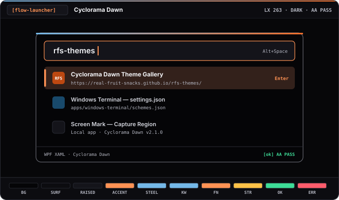
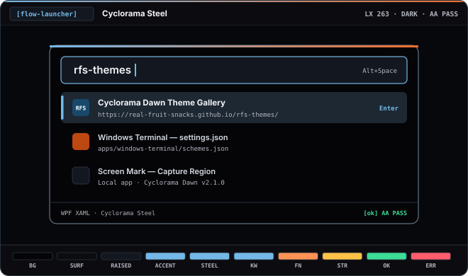
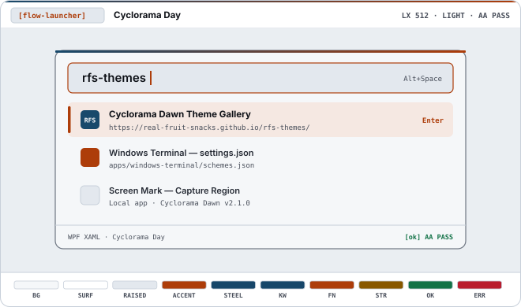

# Cyclorama Dawn for Flow Launcher

Three native WPF `ResourceDictionary` `.xaml` themes ready to drop into `%APPDATA%\FlowLauncher\Themes\`. Calibrated from [`brand/rfs.tokens.json`](../../brand/rfs.tokens.json) (**Cyclorama Dawn v2.3.2**) for **[Flow Launcher](https://www.flowlauncher.com/)** (`WPF XAML Theme`).

## Install

1. Copy `Cyclorama Dawn.xaml`, `Cyclorama Steel.xaml`, and `Cyclorama Day.xaml` into `%APPDATA%\FlowLauncher\Themes\`.
2. Restart Flow Launcher and open **Settings -> Appearance -> Theme**.
3. Select **Cyclorama Dawn**, **Cyclorama Steel**, or **Cyclorama Day**.

## Included Files

| Artifact | Path |
|---|---|
| Cyclorama Dawn XAML (LX 263) | [`Cyclorama Dawn.xaml`](Cyclorama%20Dawn.xaml) |
| Cyclorama Steel XAML (LX 263) | [`Cyclorama Steel.xaml`](Cyclorama%20Steel.xaml) |
| Cyclorama Day XAML (LX 512) | [`Cyclorama Day.xaml`](Cyclorama%20Day.xaml) |

## Variants

| Variant | Lighting Cue | Mode | Primary Accent | Background | Surface | Accent | Secondary |
|---|---|---|---|---|---|---|---|
| **Cyclorama Dawn** | `LX 263` | dark | Beacon Orange | `#050507` | `#0C0C10` | `#FF9254` | `#74B8E8` |
| **Cyclorama Steel** | `LX 263` | dark | Steel Blue | `#050507` | `#0C0C10` | `#74B8E8` | `#FF9254` |
| **Cyclorama Day** | `LX 512` | light | Alabaster Day | `#F5F7F9` | `#FFFFFF` | `#AD3D0A` | `#164669` |

### 1. Cyclorama Dawn (`LX 263 · Beacon Orange`)

Matte #050507 spotlight dialog with crisp #62646D frame, Beacon Orange caret/matches, and Steel Blue clock readout.



### 2. Cyclorama Steel (`LX 263 · Steel Blue`)

Cool steel-charcoal spotlight window with Steel Blue selection accent, crisp separators, and Beacon Orange clock readout.



### 3. Cyclorama Day (`LX 512 · Alabaster Day`)

Alabaster Day #F5F7F9 light spotlight dialog with high-contrast dark ink and burnt Beacon match highlights.



## Regenerating

```sh
python tools/build_desktop.py
```

Browse all ports in the [Cyclorama Dawn Theme Gallery](https://real-fruit-snacks.github.io/rfs-themes/) or on [GitHub](https://github.com/Real-Fruit-Snacks/rfs-themes).
