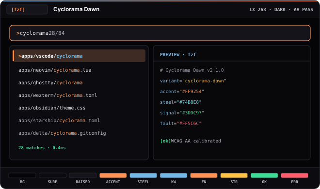
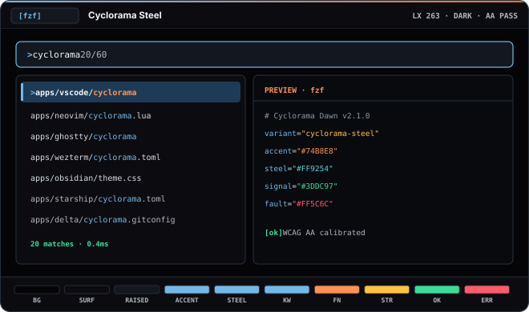
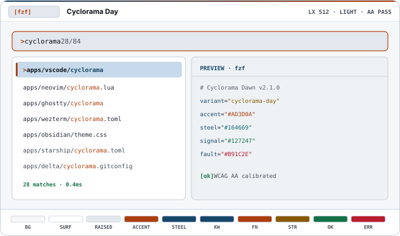

# Cyclorama Dawn for fzf

Three **Cyclorama Dawn v2.3.2 (Steel & Beacon Orange)** themes for **[fzf](https://github.com/junegunn/fzf)**, built from [`Real-Fruit-Snacks/rfs-brand`](https://github.com/Real-Fruit-Snacks/rfs-brand) tokens in [`Real-Fruit-Snacks/rfs-themes`](https://github.com/Real-Fruit-Snacks/rfs-themes). Includes both POSIX shell (`.sh`) and PowerShell (`.ps1`) scripts defining all 16 fzf color slots.

## Install

1. Bash / Zsh: add `source /path/to/rfs-themes/apps/fzf/cyclorama-dawn.sh` to `~/.bashrc` or `~/.zshrc`.
2. Windows PowerShell / pwsh: add `. C:\path\to\rfs-themes\apps\fzf\cyclorama-dawn.ps1` to your `$PROFILE`.
3. Open a new shell session and run `fzf` to confirm the Cyclorama Dawn palette.

```sh
# Bash / Zsh (~/.bashrc or ~/.zshrc)
source /path/to/rfs-themes/apps/fzf/cyclorama-dawn.sh
```

```powershell
# PowerShell ($PROFILE)
. C:\path\to\rfs-themes\apps\fzf\cyclorama-dawn.ps1
```

## Variants

| Variant | Lighting Cue | Mode | Accent Role | Background | Accent | Secondary | Files |
|---|---|---|---|---|---|---|---|
| **Cyclorama Dawn** | `LX 263` | Dark | Beacon Orange | `#050507` | `#FF9254` | `#74B8E8` | [`cyclorama-dawn.sh`](cyclorama-dawn.sh), [`cyclorama-dawn.ps1`](cyclorama-dawn.ps1) |
| **Cyclorama Steel** | `LX 263` | Dark | Steel Blue | `#050507` | `#74B8E8` | `#FF9254` | [`cyclorama-steel.sh`](cyclorama-steel.sh), [`cyclorama-steel.ps1`](cyclorama-steel.ps1) |
| **Cyclorama Day** | `LX 512` | Light | Alabaster Day | `#F5F7F9` | `#AD3D0A` | `#164669` | [`cyclorama-day.sh`](cyclorama-day.sh), [`cyclorama-day.ps1`](cyclorama-day.ps1) |

### 1. Cyclorama Dawn (`LX 263 Dark · Beacon Orange`)

Matte dark fzf palette with Beacon Orange pointers and active matches, Steel Blue highlights, and Signal markers.



### 2. Cyclorama Steel (`LX 263 Dark · Steel Blue`)

Steel-charcoal dark fzf palette with Steel Blue focus, Beacon Orange match highlights, and crisp selection contrast.



### 3. Cyclorama Day (`LX 512 Light · Alabaster Day`)

Alabaster Day light fzf palette with soft Steel active rows, burnt Beacon pointers, and AA-verified text contrast.



## Regenerating

```sh
python tools/build_cli.py
```
