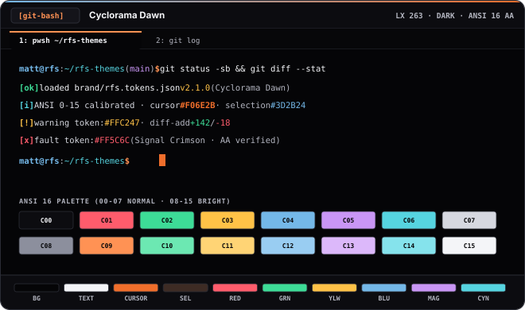
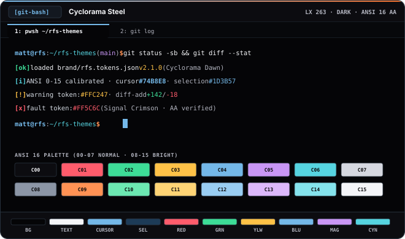
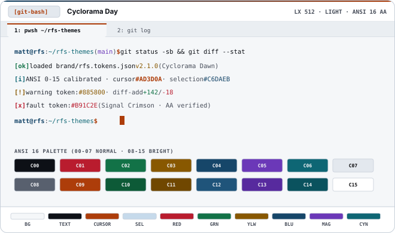

# Cyclorama Dawn for Git Bash (Mintty) & Git CLI

Three **Cyclorama Dawn v2.3.2 (Steel & Beacon Orange)** themes for **[Git Bash / Mintty](https://gitforwindows.org/)** (official decimal `R,G,B` `.minttyrc` format) paired with native truecolor **Git CLI** `.gitconfig` color profiles (`diff`, `status`, `branch`, `grep`), calibrated from [`Real-Fruit-Snacks/rfs-brand`](https://github.com/Real-Fruit-Snacks/rfs-brand).

## Variants

| Variant | Lighting | Mode | Accent Role | Theme File | Git CLI Colors |
|---|---|---|---|---|---|
| **Cyclorama Dawn** | `LX 263` | `dark` | Beacon Orange | [`cyclorama-dawn.minttyrc`](cyclorama-dawn.minttyrc) | [`git-colors-dawn.gitconfig`](git-colors-dawn.gitconfig) |
| **Cyclorama Steel** | `LX 263` | `dark` | Steel Blue | [`cyclorama-steel.minttyrc`](cyclorama-steel.minttyrc) | [`git-colors-steel.gitconfig`](git-colors-steel.gitconfig) |
| **Cyclorama Day** | `LX 512` | `light` | Alabaster Day | [`cyclorama-day.minttyrc`](cyclorama-day.minttyrc) | [`git-colors-day.gitconfig`](git-colors-day.gitconfig) |

## Install

### 1. Git Bash (Mintty)

1. Copy the desired `.minttyrc` file into `~/.mintty/themes/` (or `C:\Program Files\Git\usr\share\mintty\themes\`).
2. Add the theme selector to `~/.minttyrc` (or choose it via **Right-click title bar -> Options -> Looks -> Theme**):

```conf
ThemeFile=cyclorama-dawn.minttyrc
```

### 2. Native Git CLI Truecolor Output

Include the matching `git-colors-*.gitconfig` file in your `~/.gitconfig`:

```ini
[include]
    path = ~/rfs-themes/apps/git-bash/git-colors-dawn.gitconfig
```

Verify the loaded colors with:

```sh
git config --list --show-origin | grep '^.*color\.'
```

## Previews

### 1. Cyclorama Dawn (`LX 263 Dark · Beacon Orange`)

Matte #050507 dark stage with Beacon Orange focus and Steel Blue secondary accents.



### 2. Cyclorama Steel (`LX 263 Dark · Steel Blue`)

Cool steel-charcoal dark stage with Steel Blue controls and Beacon Orange highlights.



### 3. Cyclorama Day (`LX 512 Light · Alabaster Day`)

Crisp #F5F7F9 Alabaster Day light workspace with white panels, burnt Beacon links, and Steel buttons.



## Palette Mapping

| Role | Cyclorama Dawn (`LX 263`) | Cyclorama Steel (`LX 263`) | Cyclorama Day (`LX 512`) |
|---|---|---|---|
| Background / Foreground | `#050507` / `#F4F5F8` | `#050507` / `#F4F5F8` | `#F5F7F9` / `#0D1016` |
| Cursor / Cursor Text | `#F06E2B` / `#050507` | `#74B8E8` / `#050507` | `#AD3D0A` / `#FFFFFF` |
| Accent / Secondary | `#FF9254` / `#74B8E8` | `#74B8E8` / `#FF9254` | `#AD3D0A` / `#164669` |
| ANSI Red / Green / Yellow | `#FF5C6C` / `#3DDC97` / `#FFC247` | `#FF5C6C` / `#3DDC97` / `#FFC247` | `#B91C2E` / `#127247` / `#885800` |
| ANSI Blue / Magenta / Cyan | `#74B8E8` / `#C996F5` / `#56D4E0` | `#74B8E8` / `#C996F5` / `#56D4E0` | `#164669` / `#6B38B8` / `#0E6674` |

## Regenerating

```sh
python tools/build_extras_shells.py
```

Browse all ports in the [Cyclorama Dawn Theme Gallery](https://real-fruit-snacks.github.io/rfs-themes/) or on [GitHub](https://github.com/Real-Fruit-Snacks/rfs-themes).
