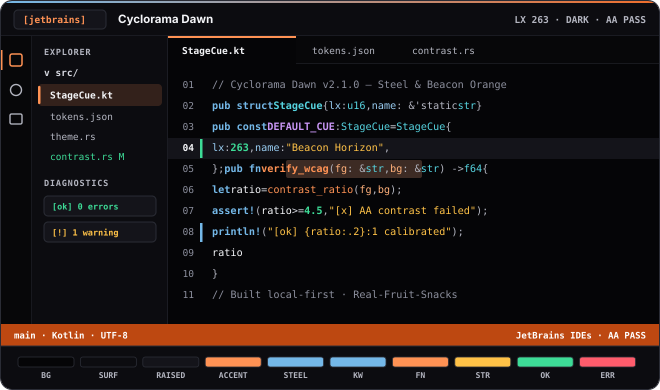
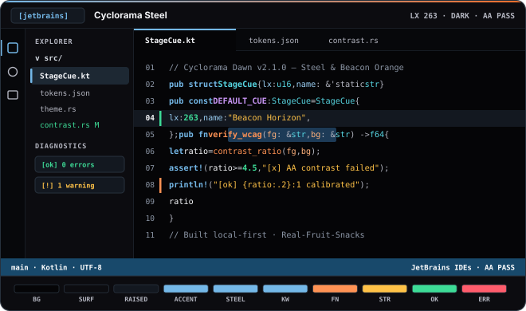
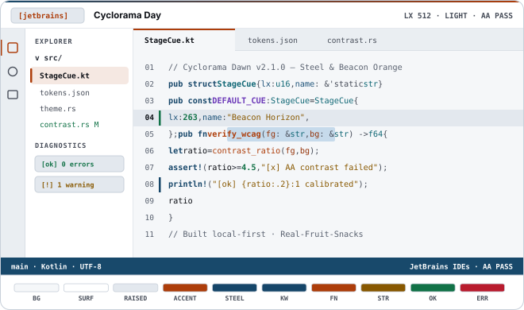

# Cyclorama Dawn for JetBrains IDEs

Three **Cyclorama Dawn v2.1.0 (Steel & Beacon Orange)** themes for **[JetBrains IDEs](https://www.jetbrains.com/)**, built from [`Real-Fruit-Snacks/rfs-brand`](https://github.com/Real-Fruit-Snacks/rfs-brand) with WCAG AA calibrated surfaces, syntax tokens, and ANSI 0-15 terminal colors.

- **Category:** Editors & IDEs
- **Format:** `IntelliJ .icls + .theme.json`
- **Gallery:** [https://real-fruit-snacks.github.io/rfs-themes/](https://real-fruit-snacks.github.io/rfs-themes/)

## Install

1. **Editor colors only:** open **Settings -> Editor -> Color Scheme**, click the gear icon -> **Import Scheme -> IntelliJ IDEA color scheme (.icls)**, and select `schemes/Cyclorama Dawn.icls` (or Steel / Day).
2. **Full UI + Editor plugin:** zip `apps/jetbrains/` (`META-INF/`, `themes/`, `schemes/`) into `cyclorama-dawn-jetbrains.jar` and install via **Settings -> Plugins -> Install Plugin from Disk...**.
3. Switch themes anytime from **Settings -> Appearance & Behavior -> Appearance -> Theme**.

Works across **IntelliJ IDEA**, **PyCharm**, **WebStorm**, **RustRover**, **Rider**, **GoLand**, **CLion**, and **Android Studio**. UI theme JSON files: [`cyclorama-dawn.theme.json`](themes/cyclorama-dawn.theme.json), [`cyclorama-steel.theme.json`](themes/cyclorama-steel.theme.json), [`cyclorama-day.theme.json`](themes/cyclorama-day.theme.json). Plugin descriptor: [`META-INF/plugin.xml`](META-INF/plugin.xml).

## Variants

| Variant | LX | Mode | Accent Role | Background | Accent | Secondary | File |
|---|---|---|---|---|---|---|---|
| **Cyclorama Dawn** | `LX 263` | `dark` | Beacon Orange | `#050507` | `#FF9254` | `#74B8E8` | [`schemes/Cyclorama Dawn.icls`](schemes/Cyclorama%20Dawn.icls) |
| **Cyclorama Steel** | `LX 263` | `dark` | Steel Blue | `#050507` | `#74B8E8` | `#FF9254` | [`schemes/Cyclorama Steel.icls`](schemes/Cyclorama%20Steel.icls) |
| **Cyclorama Day** | `LX 512` | `light` | Alabaster Day | `#F5F7F9` | `#AD3D0A` | `#164669` | [`schemes/Cyclorama Day.icls`](schemes/Cyclorama%20Day.icls) |

## Previews

### Cyclorama Dawn (`LX 263` · Beacon Orange)

Matte #050507 dark stage with Beacon Orange focus and Steel Blue secondary accents.



### Cyclorama Steel (`LX 263` · Steel Blue)

Cool steel-charcoal dark stage with Steel Blue controls and Beacon Orange highlights.



### Cyclorama Day (`LX 512` · Alabaster Day)

Crisp #F5F7F9 Alabaster Day light workspace with white panels, burnt Beacon links, and Steel buttons.



## Regenerating

```sh
python tools/build_editors.py
```
