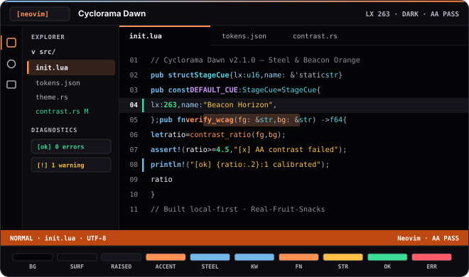
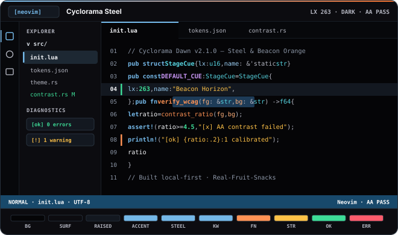
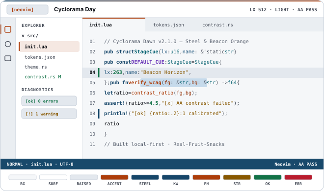

# Cyclorama Dawn for Neovim

Three **Cyclorama Dawn v2.1.0 (Steel & Beacon Orange)** themes for **[Neovim](https://neovim.io/)**, built from [`Real-Fruit-Snacks/rfs-brand`](https://github.com/Real-Fruit-Snacks/rfs-brand) with WCAG AA calibrated surfaces, syntax tokens, and ANSI 0-15 terminal colors.

- **Category:** Editors & IDEs
- **Format:** `Lua Colorscheme Plugin`
- **Gallery:** [https://real-fruit-snacks.github.io/rfs-themes/](https://real-fruit-snacks.github.io/rfs-themes/)

## Install

1. Clone `rfs-themes` or copy `apps/neovim/` into your Neovim plugin directory (or add via `lazy.nvim` using `rtp:append`).
2. Run `:colorscheme cyclorama-dawn`, `:colorscheme cyclorama-steel`, or `:colorscheme cyclorama-day`.
3. Optional: pass `theme = require("cyclorama.lualine")` to `lualine.nvim` for a matched statusline.

Includes Treesitter (`@...`), LSP semantic tokens (`@lsp.type.*`), Diagnostics, Telescope, Gitsigns, Neo-tree, WhichKey, Lualine (`require("cyclorama.lualine")`), and ANSI 0-15 terminal colors.

## Variants

| Variant | LX | Mode | Accent Role | Background | Accent | Secondary | File |
|---|---|---|---|---|---|---|---|
| **Cyclorama Dawn** | `LX 263` | `dark` | Beacon Orange | `#050507` | `#FF9254` | `#74B8E8` | [`colors/cyclorama-dawn.lua`](colors/cyclorama-dawn.lua) |
| **Cyclorama Steel** | `LX 263` | `dark` | Steel Blue | `#050507` | `#74B8E8` | `#FF9254` | [`colors/cyclorama-steel.lua`](colors/cyclorama-steel.lua) |
| **Cyclorama Day** | `LX 512` | `light` | Alabaster Day | `#F5F7F9` | `#AD3D0A` | `#164669` | [`colors/cyclorama-day.lua`](colors/cyclorama-day.lua) |

## Previews

### Cyclorama Dawn (`LX 263` · Beacon Orange)

Matte #050507 dark stage with Beacon Orange focus and Steel Blue secondary accents.



### Cyclorama Steel (`LX 263` · Steel Blue)

Cool steel-charcoal dark stage with Steel Blue controls and Beacon Orange highlights.



### Cyclorama Day (`LX 512` · Alabaster Day)

Crisp #F5F7F9 Alabaster Day light workspace with white panels, burnt Beacon links, and Steel buttons.



## Regenerating

```sh
python tools/build_editors.py
```
