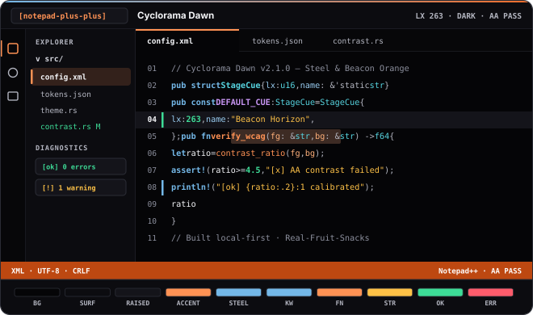
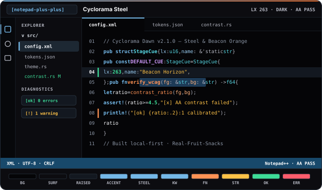
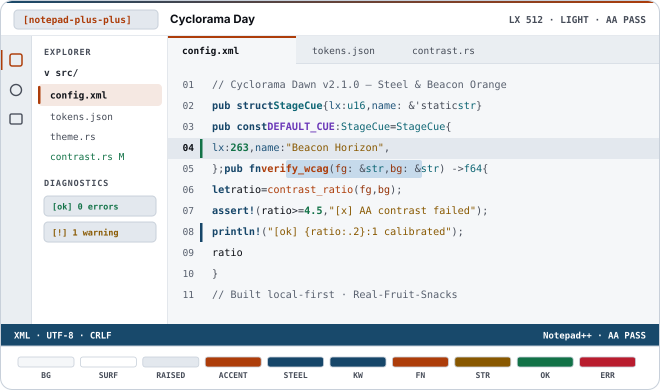

# Cyclorama Dawn for Notepad++

Three **Cyclorama Dawn v2.1.0 (Steel & Beacon Orange)** themes for **[Notepad++](https://notepad-plus-plus.org/)**, built from [`Real-Fruit-Snacks/rfs-brand`](https://github.com/Real-Fruit-Snacks/rfs-brand) with WCAG AA calibrated surfaces, syntax tokens, and editor chrome.

- **Category:** Editors & IDEs
- **Format:** `Notepad++ XML + Dark Mode .ps1`
- **Gallery:** [https://real-fruit-snacks.github.io/rfs-themes/](https://real-fruit-snacks.github.io/rfs-themes/)

## Install

1. Close Notepad++ so it does not overwrite `config.xml` on exit.
2. Run `powershell -ExecutionPolicy Bypass -File apps/notepad-plus-plus/apply-cyclorama-dawn.ps1` (or `steel` / `day`). The script copies all three `.xml` files into `%APPDATA%\Notepad++\themes\`, writes a one-time `config.xml.pre-rfs.bak` backup, and configures Notepad++ 8.x Custom Dark Mode (`colorTone="32"`) or Day light mode.
3. Alternatively, copy `Cyclorama Dawn.xml`, `Cyclorama Steel.xml`, and `Cyclorama Day.xml` into `%APPDATA%\Notepad++\themes\` and select the theme in **Settings -> Style Configurator**.

Includes 19 authentic Notepad++ 8.x `<LexerType>` syntax definitions (`c`, `cpp`, `cs`, `rust`, `python`, `powershell`, `bash`, `javascript.js`, `typescript`, `json`, `yaml`, `html`, `css`, `xml`, `markdown`, `sql`, `ini`, `diff`, `batch`) plus backup-first PowerShell appliers: [`apply-cyclorama-dawn.ps1`](apply-cyclorama-dawn.ps1), [`apply-cyclorama-steel.ps1`](apply-cyclorama-steel.ps1), and [`apply-cyclorama-day.ps1`](apply-cyclorama-day.ps1).

## Variants

| Variant | LX | Mode | Accent Role | Background | Accent | Secondary | File |
|---|---|---|---|---|---|---|---|
| **Cyclorama Dawn** | `LX 263` | `dark` | Beacon Orange | `#050507` | `#FF9254` | `#74B8E8` | [`Cyclorama Dawn.xml`](Cyclorama%20Dawn.xml) |
| **Cyclorama Steel** | `LX 263` | `dark` | Steel Blue | `#050507` | `#74B8E8` | `#FF9254` | [`Cyclorama Steel.xml`](Cyclorama%20Steel.xml) |
| **Cyclorama Day** | `LX 512` | `light` | Alabaster Day | `#F5F7F9` | `#AD3D0A` | `#164669` | [`Cyclorama Day.xml`](Cyclorama%20Day.xml) |

## Previews

### Cyclorama Dawn (`LX 263` · Beacon Orange)

Matte #050507 dark stage with Beacon Orange focus and Steel Blue secondary accents.



### Cyclorama Steel (`LX 263` · Steel Blue)

Cool steel-charcoal dark stage with Steel Blue controls and Beacon Orange highlights.



### Cyclorama Day (`LX 512` · Alabaster Day)

Crisp #F5F7F9 Alabaster Day light workspace with white panels, burnt Beacon links, and Steel buttons.



## Regenerating

```sh
python tools/build_extras_editors.py
```
