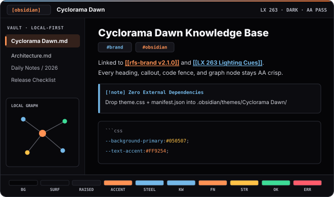
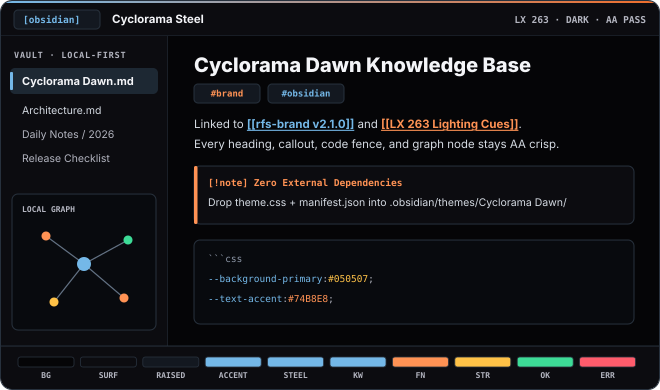
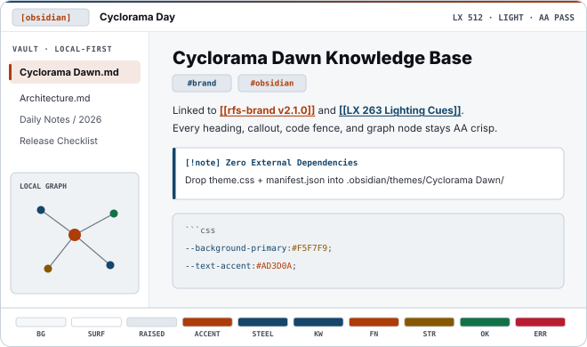

# Cyclorama Dawn for Obsidian

Full community theme (`manifest.json` + `theme.css`) with built-in Style Settings support and three standalone CSS snippets. Calibrated from [`brand/rfs.tokens.json`](../../brand/rfs.tokens.json) (**Cyclorama Dawn v2.1.0**) for **[Obsidian](https://obsidian.md/)** (`Obsidian Theme (manifest.json + theme.css)`).

## Install

1. Copy `manifest.json` and `theme.css` into your vault's `.obsidian/themes/Cyclorama Dawn/` folder.
2. Open Obsidian -> Settings -> Appearance -> Themes and select **Cyclorama Dawn**.
3. Use Base color scheme to switch between **Cyclorama Dawn** (`LX 263` Dark) and **Cyclorama Day** (`LX 512` Light), or enable `snippets/cyclorama-steel.css` (or Style Settings) for **Cyclorama Steel**.

## Included Files

| Artifact | Path |
|---|---|
| Theme Manifest | [`manifest.json`](manifest.json) |
| Complete Theme CSS | [`theme.css`](theme.css) |
| Dawn Snippet (LX 263) | [`snippets/cyclorama-dawn.css`](snippets/cyclorama-dawn.css) |
| Steel Snippet (LX 263) | [`snippets/cyclorama-steel.css`](snippets/cyclorama-steel.css) |
| Day Snippet (LX 512) | [`snippets/cyclorama-day.css`](snippets/cyclorama-day.css) |

## Variants

| Variant | Lighting Cue | Mode | Primary Accent | Background | Surface | Accent | Secondary |
|---|---|---|---|---|---|---|---|
| **Cyclorama Dawn** | `LX 263` | dark | Beacon Orange | `#050507` | `#0C0C10` | `#FF9254` | `#74B8E8` |
| **Cyclorama Steel** | `LX 263` | dark | Steel Blue | `#050507` | `#0C0C10` | `#74B8E8` | `#FF9254` |
| **Cyclorama Day** | `LX 512` | light | Alabaster Day | `#F5F7F9` | `#FFFFFF` | `#AD3D0A` | `#164669` |

### 1. Cyclorama Dawn (`LX 263 · Beacon Orange`)

Matte #050507 dark vault with Beacon Orange links, Steel Blue tags, and AA-calibrated callouts and graph nodes.



### 2. Cyclorama Steel (`LX 263 · Steel Blue`)

Cool steel-charcoal dark vault with Steel Blue controls and Beacon Orange secondary highlights via Style Settings or snippet.



### 3. Cyclorama Day (`LX 512 · Alabaster Day`)

Crisp #F5F7F9 Alabaster Day light vault with white sidebars, burnt Beacon links, and Steel Blue tags.



## Regenerating

```sh
python tools/build_desktop.py
```

Browse all ports in the [Cyclorama Dawn Theme Gallery](https://real-fruit-snacks.github.io/rfs-themes/) or on [GitHub](https://github.com/Real-Fruit-Snacks/rfs-themes).
