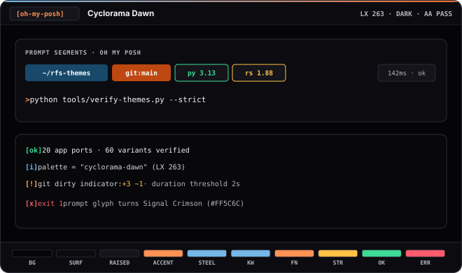
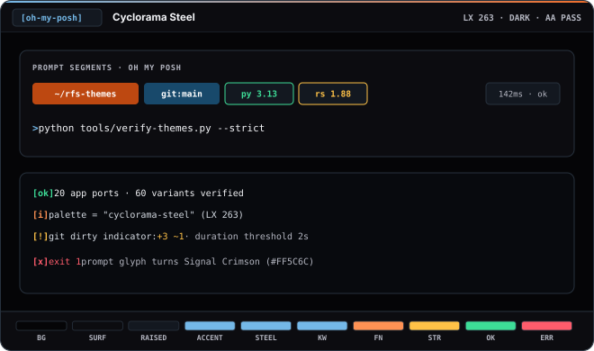
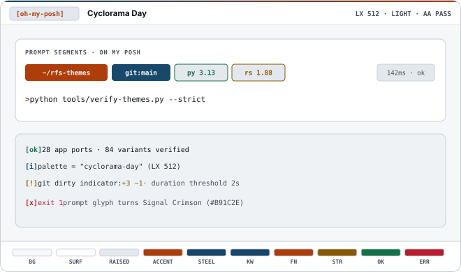

# Cyclorama Dawn for Oh My Posh

Three **Cyclorama Dawn v2.1.0 (Steel & Beacon Orange)** themes for **[Oh My Posh](https://ohmyposh.dev/)**, built from [`Real-Fruit-Snacks/rfs-brand`](https://github.com/Real-Fruit-Snacks/rfs-brand) tokens in [`Real-Fruit-Snacks/rfs-themes`](https://github.com/Real-Fruit-Snacks/rfs-themes). Every `.omp.json` uses the Oh My Posh v3 schema and `p:<key>` palette lookups for path, git, Python, Rust, Node.js, execution time, status, and prompt glyph blocks.

## Install

1. Copy `cyclorama-dawn.omp.json` (or `steel` / `day`) into your Oh My Posh themes folder.
2. Initialize Oh My Posh in your shell profile (`~/.zshrc`, `~/.bashrc`, or PowerShell `$PROFILE`) with `--config` pointing to the `.omp.json` file.
3. Reload your shell profile to activate the prompt.

```powershell
# PowerShell ($PROFILE)
oh-my-posh init pwsh --config "$HOME/.config/oh-my-posh/cyclorama-dawn.omp.json" | Invoke-Expression
```

```sh
# Bash / Zsh
eval "$(oh-my-posh init zsh --config ~/.config/oh-my-posh/cyclorama-dawn.omp.json)"
```

## Variants

| Variant | Lighting Cue | Mode | Accent Role | Background | Accent | Secondary | Files |
|---|---|---|---|---|---|---|---|
| **Cyclorama Dawn** | `LX 263` | Dark | Beacon Orange | `#050507` | `#FF9254` | `#74B8E8` | [`cyclorama-dawn.omp.json`](cyclorama-dawn.omp.json) |
| **Cyclorama Steel** | `LX 263` | Dark | Steel Blue | `#050507` | `#74B8E8` | `#FF9254` | [`cyclorama-steel.omp.json`](cyclorama-steel.omp.json) |
| **Cyclorama Day** | `LX 512` | Light | Alabaster Day | `#F5F7F9` | `#AD3D0A` | `#164669` | [`cyclorama-day.omp.json`](cyclorama-day.omp.json) |

### 1. Cyclorama Dawn (`LX 263 Dark · Beacon Orange`)

Oh My Posh v3 dark prompt using p:<token> palette references with Beacon Orange git badges and Steel Blue paths.



### 2. Cyclorama Steel (`LX 263 Dark · Steel Blue`)

Oh My Posh v3 steel-charcoal dark prompt with Steel Blue primary pills and Beacon Orange highlights.



### 3. Cyclorama Day (`LX 512 Light · Alabaster Day`)

Oh My Posh v3 Alabaster Day light prompt with crisp Steel and burnt Beacon contrast across every segment.



## Regenerating

```sh
python tools/build_cli.py
```
