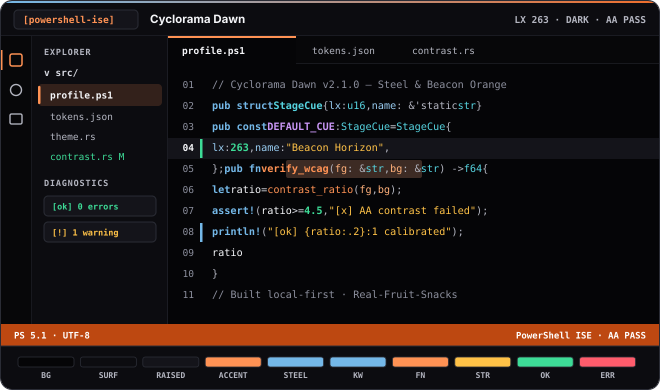
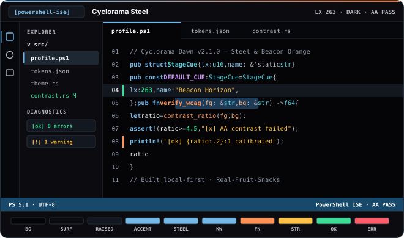
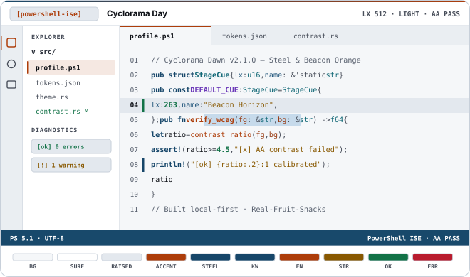

# Cyclorama Dawn for Windows PowerShell ISE

Three **Cyclorama Dawn v2.1.0 (Steel & Beacon Orange)** themes for **[Windows PowerShell ISE](https://learn.microsoft.com/en-us/powershell/scripting/windows-powershell/ise/introducing-the-windows-powershell-ise)**, built from [`Real-Fruit-Snacks/rfs-brand`](https://github.com/Real-Fruit-Snacks/rfs-brand) with WCAG AA calibrated surfaces, syntax tokens, and editor chrome.

- **Category:** Editors & IDEs
- **Format:** `.StorableColorTheme.ps1xml`
- **Gallery:** [https://real-fruit-snacks.github.io/rfs-themes/](https://real-fruit-snacks.github.io/rfs-themes/)

## Install

1. Run `powershell.exe -ExecutionPolicy Bypass -File apps/powershell-ise/install-cyclorama-dawn.ps1` (or `steel` / `day`) in Windows PowerShell 5.1 to validate and register the theme via `StorableColorTheme::StoreTheme()`.
2. Open **Windows PowerShell ISE** -> **Tools -> Options -> Colors and Fonts -> Manage Themes** and select **Cyclorama Dawn**, **Cyclorama Steel**, or **Cyclorama Day**.
3. Alternatively, click **Import...** inside **Manage Themes** and choose any `.StorableColorTheme.ps1xml` file directly.

Each `.StorableColorTheme.ps1xml` defines all 73 `StorableColorTheme` keys (13 pane/stream colors, 20 `TokenColors\*`, 20 `ConsoleTokenColors\*`, and 20 `XmlTokenColors\*`) with exact sRGB-to-linear `ScA`/`ScR`/`ScG`/`ScB` floats. Installers: [`install-cyclorama-dawn.ps1`](install-cyclorama-dawn.ps1), [`install-cyclorama-steel.ps1`](install-cyclorama-steel.ps1), and [`install-cyclorama-day.ps1`](install-cyclorama-day.ps1).

## Variants

| Variant | LX | Mode | Accent Role | Background | Accent | Secondary | File |
|---|---|---|---|---|---|---|---|
| **Cyclorama Dawn** | `LX 263` | `dark` | Beacon Orange | `#050507` | `#FF9254` | `#74B8E8` | [`Cyclorama Dawn.StorableColorTheme.ps1xml`](Cyclorama%20Dawn.StorableColorTheme.ps1xml) |
| **Cyclorama Steel** | `LX 263` | `dark` | Steel Blue | `#050507` | `#74B8E8` | `#FF9254` | [`Cyclorama Steel.StorableColorTheme.ps1xml`](Cyclorama%20Steel.StorableColorTheme.ps1xml) |
| **Cyclorama Day** | `LX 512` | `light` | Alabaster Day | `#F5F7F9` | `#AD3D0A` | `#164669` | [`Cyclorama Day.StorableColorTheme.ps1xml`](Cyclorama%20Day.StorableColorTheme.ps1xml) |

## Previews

### Cyclorama Dawn (`LX 263` · Beacon Orange)

Matte #050507 dark stage with Beacon Orange focus and Steel Blue secondary accents.



### Cyclorama Steel (`LX 263` · Steel Blue)

Cool steel-charcoal dark stage with Steel Blue controls and Beacon Orange highlights.



### Cyclorama Day (`LX 512` · Alabaster Day)

Crisp #F5F7F9 Alabaster Day light workspace with white panels, burnt Beacon links, and Steel buttons.



## Regenerating

```sh
python tools/build_extras_editors.py
```
