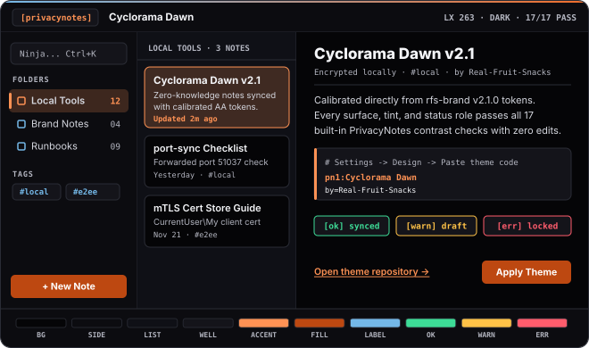
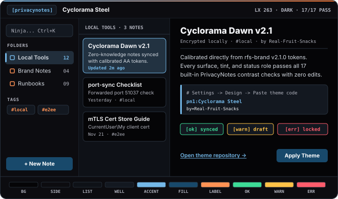
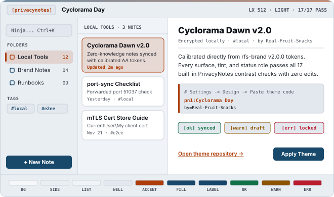

# Cyclorama Dawn for PrivacyNotes

Three **Cyclorama Dawn v2.0 (Steel & Beacon Orange)** color themes for **[PrivacyNotes](https://privacynotes.app/)**, calibrated from [`Real-Fruit-Snacks/rfs-brand`](https://github.com/Real-Fruit-Snacks/rfs-brand) and verified against **all 17** built-in `themeCode.ts` contrast checks (`state: "pass"`, zero `Fix all` adjustments).

## Install

1. Copy one of the `pn1:` theme codes below (or grab all three from [`codes.txt`](codes.txt)).
2. Open **PrivacyNotes** → **Settings → Design → Paste theme code**.
3. Switch themes anytime from the Ninja command palette (`Ctrl+K` → type `theme` or `cyclorama`).

---

## 1. Cyclorama Dawn (`LX 263 Dark · Beacon Accent`)

Matte `#050507` dark stage with Beacon Orange (`#FF9254`) focus, deep Beacon (`#BD4811`) primary buttons, and Steel Blue (`#74B8E8`) folder/tag labels.



```text
pn1:Cyclorama Dawn:050507,0C0C10,2A2C35,F4F5F8,B3B5C0,FF9254:list=0F1016,paper=050507,well=14141A,soft=D6D8E0,hover=FFB07A,fill=BD4811,fillhover=9E3B0C,danger=FF5C6C,warning=FFC247,success=3DDC97,label=74B8E8,by=Real-Fruit-Snacks
```

## 2. Cyclorama Steel (`LX 263 Dark · Steel Accent`)

Matte `#050507` dark stage with Steel Blue (`#74B8E8`) controls, deep Steel (`#18496B`) primary buttons, and Beacon Orange (`#FF9254`) folder/tag labels.



```text
pn1:Cyclorama Steel:050507,0C0C10,27313D,F4F5F8,B3B5C0,74B8E8:list=0E1117,paper=050507,well=131820,soft=D6DCE4,hover=99CDF2,fill=18496B,fillhover=123955,danger=FF5C6C,warning=FFC247,success=3DDC97,label=FF9254,by=Real-Fruit-Snacks
```

## 3. Cyclorama Day (`LX 512 Light · Alabaster Day`)

Crisp `#F5F7F9` Alabaster Day light workspace with white (`#FFFFFF`) writing paper, burnt Beacon (`#AD3D0A`) links, and Steel (`#18496B` / `#164669`) buttons and folder labels.



```text
pn1:Cyclorama Day:F5F7F9,E9EEF3,C8D0DA,0D1016,474D59,AD3D0A:list=F0F3F7,paper=FFFFFF,well=E3E8EE,soft=252A34,hover=8B2F06,fill=18496B,fillhover=113752,danger=B91C2E,warning=8D5400,success=127247,label=164669,by=Real-Fruit-Snacks
```

---

## Token Mapping

| PrivacyNotes Role | Cyclorama Dawn (`LX 263`) | Cyclorama Steel (`LX 263`) | Cyclorama Day (`LX 512`) |
|---|---|---|---|
| `background` / `paper` | `#050507` / `#050507` | `#050507` / `#050507` | `#F5F7F9` / `#FFFFFF` |
| `sidebar` / `list` / `well` | `#0C0C10` / `#0F1016` / `#14141A` | `#0C0C10` / `#0E1117` / `#131820` | `#E9EEF3` / `#F0F3F7` / `#E3E8EE` |
| `border` | `#2A2C35` | `#27313D` | `#C8D0DA` |
| `text` / `soft` / `muted` | `#F4F5F8` / `#D6D8E0` / `#B3B5C0` | `#F4F5F8` / `#D6DCE4` / `#B3B5C0` | `#0D1016` / `#252A34` / `#474D59` |
| `accent` / `hover` | `#FF9254` / `#FFB07A` | `#74B8E8` / `#99CDF2` | `#AD3D0A` / `#8B2F06` |
| `fill` / `fillhover` | `#BD4811` / `#9E3B0C` | `#18496B` / `#123955` | `#18496B` / `#113752` |
| `label` (folders & tags) | `#74B8E8` | `#FF9254` | `#164669` |
| `success` / `warning` / `danger` | `#3DDC97` / `#FFC247` / `#FF5C6C` | `#3DDC97` / `#FFC247` / `#FF5C6C` | `#127247` / `#8D5400` / `#B91C2E` |

## Regenerating & Validating

```sh
python tools/build-privacynotes.py
python tools/verify-themes.py
```
