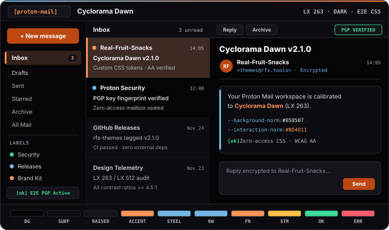
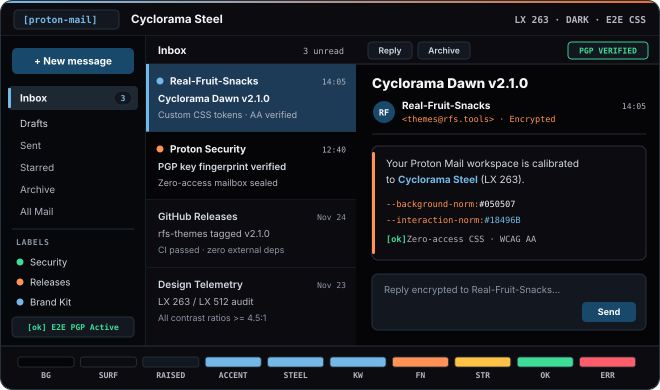
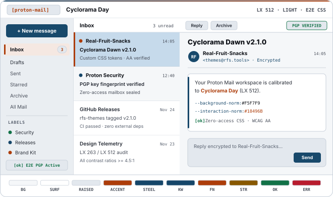

# Cyclorama Dawn for Proton Mail

Three **Cyclorama Dawn v2.1.0 (Steel & Beacon Orange)** ready-to-paste Custom Theme CSS files for **[Proton Mail](https://proton.me/mail)** (Proton Design System `:root` tokens), calibrated from [`Real-Fruit-Snacks/rfs-brand`](https://github.com/Real-Fruit-Snacks/rfs-brand).

## Variants

| Variant | Lighting | Mode | Accent Role | Theme File |
|---|---|---|---|---|
| **Cyclorama Dawn** | `LX 263` | `dark` | Beacon Orange | [`cyclorama-dawn.css`](cyclorama-dawn.css) |
| **Cyclorama Steel** | `LX 263` | `dark` | Steel Blue | [`cyclorama-steel.css`](cyclorama-steel.css) |
| **Cyclorama Day** | `LX 512` | `light` | Alabaster Day | [`cyclorama-day.css`](cyclorama-day.css) |

## Install

1. Open **Proton Mail** and go to **Settings -> All settings -> Appearance**.
2. Enable **Custom theme** and open the custom CSS text box.
3. Paste the full contents of `cyclorama-dawn.css` (or `cyclorama-steel.css` / `cyclorama-day.css`) and click **Save**.

## Previews

### 1. Cyclorama Dawn (`LX 263 Dark · Beacon Orange`)

Matte #050507 Proton Mail dark workspace with Beacon Orange (#FF9254) active indicators, high-contrast compose CTA (#BD4811), and Steel Blue info signals.



### 2. Cyclorama Steel (`LX 263 Dark · Steel Blue`)

Cool steel-charcoal Proton Mail dark workspace with Steel Blue (#74B8E8) focus rings, #18496B primary buttons, and Beacon Orange secondary highlights.



### 3. Cyclorama Day (`LX 512 Light · Alabaster Day`)

Crisp #F5F7F9 Alabaster Day light mailbox with white message panes, burnt Beacon (#AD3D0A) focus markers, and Steel Blue primary buttons.



## Token Mapping

| Proton Design Token | Cyclorama Dawn (`LX 263`) | Cyclorama Steel (`LX 263`) | Cyclorama Day (`LX 512`) |
|---|---|---|---|
| `--background-norm` / `--background-weak` | `#050507` / `#0C0C10` | `#050507` / `#0C0C10` | `#F5F7F9` / `#FFFFFF` |
| `--background-strong` / `--background-lowered` | `#14141A` / `#070709` | `#131820` / `#07080B` | `#E3E8EE` / `#EAEEF2` |
| `--interaction-norm` / `--primary` | `#BD4811` | `#18496B` | `#18496B` |
| `--text-norm` / `--text-weak` | `#F4F5F8` / `#B3B5C0` | `#F4F5F8` / `#B3B5C0` | `#0D1016` / `#474D59` |
| `--focus-outline` / `--signal-info` | `#FF9254` / `#74B8E8` | `#74B8E8` / `#FF9254` | `#AD3D0A` / `#164669` |
| `--signal-success` / `--signal-danger` | `#3DDC97` / `#FF5C6C` | `#3DDC97` / `#FF5C6C` | `#127247` / `#B91C2E` |

## Regenerating

```sh
python tools/build_extras_shells.py
```

Browse all ports in the [Cyclorama Dawn Theme Gallery](https://real-fruit-snacks.github.io/rfs-themes/) or on [GitHub](https://github.com/Real-Fruit-Snacks/rfs-themes).
