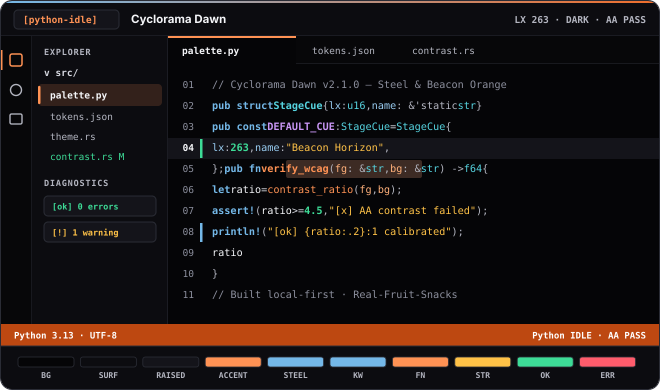
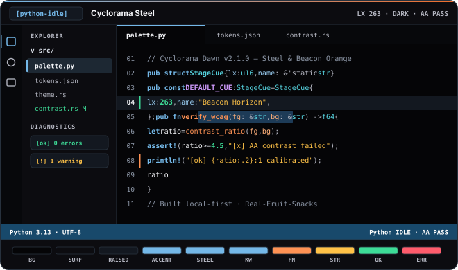
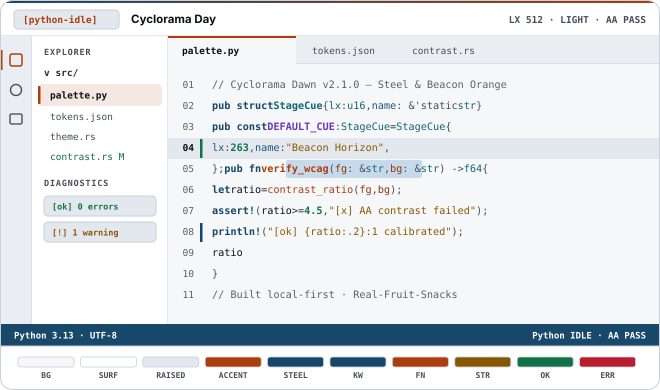

# Cyclorama Dawn for Python IDLE

Three **Cyclorama Dawn v2.3.2 (Steel & Beacon Orange)** themes for **[Python IDLE](https://docs.python.org/3/library/idle.html)**, built from [`Real-Fruit-Snacks/rfs-brand`](https://github.com/Real-Fruit-Snacks/rfs-brand) with WCAG AA calibrated surfaces, syntax tokens, and editor chrome.

- **Category:** Editors & IDEs
- **Format:** `IDLE config-highlight.cfg`
- **Gallery:** [https://real-fruit-snacks.github.io/rfs-themes/](https://real-fruit-snacks.github.io/rfs-themes/)

## Install

1. Copy or append `apps/python-idle/config-highlight.cfg` into `~/.idlerc/config-highlight.cfg` (on Windows: `%USERPROFILE%\.idlerc\config-highlight.cfg`).
2. Open Python IDLE -> **Options -> Configure IDLE -> Highlights**, select **a Custom Theme**, and pick **Cyclorama Dawn**, **Cyclorama Steel**, or **Cyclorama Day**.
3. Optional: copy the matching `config-main-dawn.cfg`, `config-main-steel.cfg`, or `config-main-day.cfg` `[Theme]` block into `~/.idlerc/config-main.cfg` to activate immediately.

Unified 3-variant highlight file: [`config-highlight.cfg`](config-highlight.cfg). Drop-in `config-main.cfg` selectors: [`config-main-dawn.cfg`](config-main-dawn.cfg), [`config-main-steel.cfg`](config-main-steel.cfg), and [`config-main-day.cfg`](config-main-day.cfg). Every one of the 31 official Python 3.13/3.14 `idlelib/config-highlight.def` slots is verified to meet `>= 4.5:1` WCAG AA contrast.

## Variants

| Variant | LX | Mode | Accent Role | Background | Accent | Secondary | File |
|---|---|---|---|---|---|---|---|
| **Cyclorama Dawn** | `LX 263` | `dark` | Beacon Orange | `#050507` | `#FF9254` | `#74B8E8` | [`cyclorama-dawn.cfg`](cyclorama-dawn.cfg) |
| **Cyclorama Steel** | `LX 263` | `dark` | Steel Blue | `#050507` | `#74B8E8` | `#FF9254` | [`cyclorama-steel.cfg`](cyclorama-steel.cfg) |
| **Cyclorama Day** | `LX 512` | `light` | Alabaster Day | `#F5F7F9` | `#AD3D0A` | `#164669` | [`cyclorama-day.cfg`](cyclorama-day.cfg) |

## Previews

### Cyclorama Dawn (`LX 263` · Beacon Orange)

Matte #050507 dark stage with Beacon Orange focus and Steel Blue secondary accents.



### Cyclorama Steel (`LX 263` · Steel Blue)

Cool steel-charcoal dark stage with Steel Blue controls and Beacon Orange highlights.



### Cyclorama Day (`LX 512` · Alabaster Day)

Crisp #F5F7F9 Alabaster Day light workspace with white panels, burnt Beacon links, and Steel buttons.



## Regenerating

```sh
python tools/build_extras_editors.py
```
