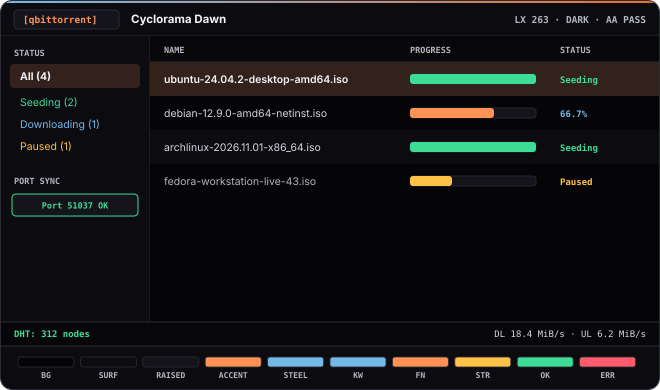
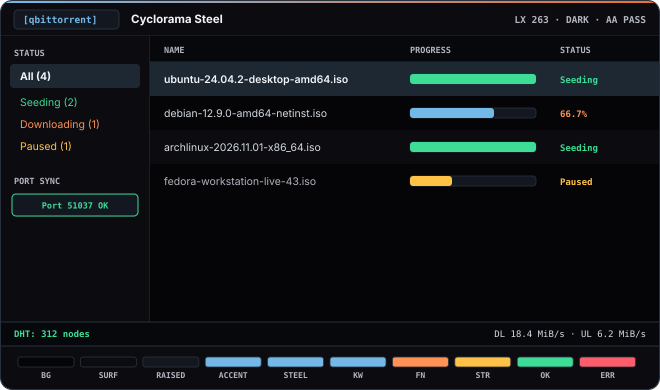
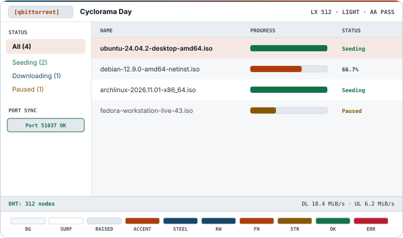

# Cyclorama Dawn for qBittorrent

Three Qt QSS stylesheets paired with qBittorrent `config.json` transfer-list and log color palettes. Calibrated from [`brand/rfs.tokens.json`](../../brand/rfs.tokens.json) (**Cyclorama Dawn v2.1.0**) for **[qBittorrent](https://www.qbittorrent.org/)** (`Qt QSS Stylesheet + config.json`).

## Install

1. Choose a variant folder (`apps/qbittorrent/cyclorama-dawn/`, `cyclorama-steel/`, or `cyclorama-day/`) containing `config.json` and `stylesheet.qss`.
2. **qBittorrent 5.x (recommended, no `rcc` needed):** Open Tools -> Options -> **Behavior** -> enable **Use custom UI theme** -> select `config.json` directly (`FolderThemeSource` automatically loads sibling `stylesheet.qss` alongside `colors.dark` / `colors.light`).
3. **qBittorrent 4.x legacy:** Bundle `stylesheet.qss` and `config.json` into a `.qbtheme` resource file with Qt `rcc`, select it under Behavior -> Use custom UI theme, and restart qBittorrent.

## Included Files

| Artifact | Path |
|---|---|
| Dawn Stylesheet (QSS) | [`cyclorama-dawn/stylesheet.qss`](cyclorama-dawn/stylesheet.qss) |
| Dawn Transfer Palette (JSON) | [`cyclorama-dawn/config.json`](cyclorama-dawn/config.json) |
| Steel Stylesheet (QSS) | [`cyclorama-steel/stylesheet.qss`](cyclorama-steel/stylesheet.qss) |
| Steel Transfer Palette (JSON) | [`cyclorama-steel/config.json`](cyclorama-steel/config.json) |
| Day Stylesheet (QSS) | [`cyclorama-day/stylesheet.qss`](cyclorama-day/stylesheet.qss) |
| Day Transfer Palette (JSON) | [`cyclorama-day/config.json`](cyclorama-day/config.json) |

## Variants

| Variant | Lighting Cue | Mode | Primary Accent | Background | Surface | Accent | Secondary |
|---|---|---|---|---|---|---|---|
| **Cyclorama Dawn** | `LX 263` | dark | Beacon Orange | `#050507` | `#0C0C10` | `#FF9254` | `#74B8E8` |
| **Cyclorama Steel** | `LX 263` | dark | Steel Blue | `#050507` | `#0C0C10` | `#74B8E8` | `#FF9254` |
| **Cyclorama Day** | `LX 512` | light | Alabaster Day | `#F5F7F9` | `#FFFFFF` | `#AD3D0A` | `#164669` |

### 1. Cyclorama Dawn (`LX 263 · Beacon Orange`)

Matte #050507 transfer table with Beacon Orange progress bars, Signal green seeding, and Steel Blue active downloads.



### 2. Cyclorama Steel (`LX 263 · Steel Blue`)

Cool steel-charcoal Qt stylesheet with Steel Blue progress chunks, crisp #27313D gridlines, and Beacon checking states.



### 3. Cyclorama Day (`LX 512 · Alabaster Day`)

Alabaster Day #F5F7F9 light Qt stylesheet with alternating cool rows and WCAG AA transfer status inks.



## Regenerating

```sh
python tools/build_desktop.py
```

Browse all ports in the [Cyclorama Dawn Theme Gallery](https://real-fruit-snacks.github.io/rfs-themes/) or on [GitHub](https://github.com/Real-Fruit-Snacks/rfs-themes).
