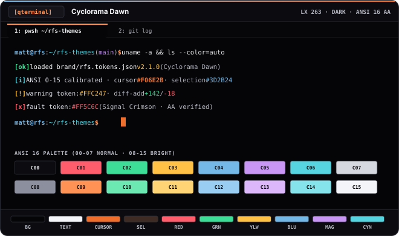
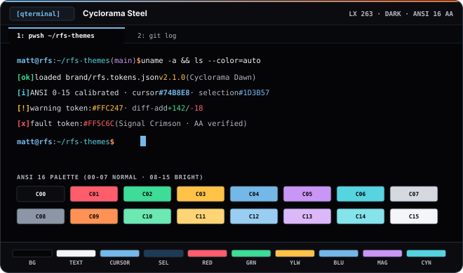
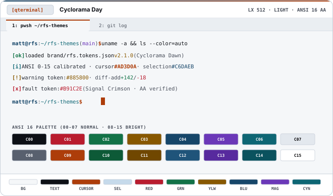

# Cyclorama Dawn for QTerminal

Three **Cyclorama Dawn v2.3.2 (Steel & Beacon Orange)** QTermWidget / Konsole INI color schemes for **[QTerminal](https://github.com/lxqt/qterminal)** (WSL / Linux / LXQt), calibrated from [`Real-Fruit-Snacks/rfs-brand`](https://github.com/Real-Fruit-Snacks/rfs-brand).

## Variants

| Variant | Lighting | Mode | Accent Role | Theme File |
|---|---|---|---|---|
| **Cyclorama Dawn** | `LX 263` | `dark` | Beacon Orange | [`Cyclorama Dawn.colorscheme`](Cyclorama%20Dawn.colorscheme) |
| **Cyclorama Steel** | `LX 263` | `dark` | Steel Blue | [`Cyclorama Steel.colorscheme`](Cyclorama%20Steel.colorscheme) |
| **Cyclorama Day** | `LX 512` | `light` | Alabaster Day | [`Cyclorama Day.colorscheme`](Cyclorama%20Day.colorscheme) |

## Install

1. Copy the `.colorscheme` files into your user QTermWidget color-schemes directory:

```sh
mkdir -p ~/.local/share/qtermwidget6/color-schemes
cp "Cyclorama Dawn.colorscheme" "Cyclorama Steel.colorscheme" "Cyclorama Day.colorscheme" \
   ~/.local/share/qtermwidget6/color-schemes/
```

*(For Qt5-based QTerminal builds, copy to `~/.local/share/qtermwidget5/color-schemes/` instead.)*

2. Open QTerminal -> **File -> Preferences -> Appearance -> Color scheme** and select **Cyclorama Dawn**, **Cyclorama Steel**, or **Cyclorama Day**.
3. Click **OK** or **Apply** to activate immediately.

## Previews

### 1. Cyclorama Dawn (`LX 263 Dark · Beacon Orange`)

Matte #050507 dark stage with Beacon Orange focus and Steel Blue secondary accents.



### 2. Cyclorama Steel (`LX 263 Dark · Steel Blue`)

Cool steel-charcoal dark stage with Steel Blue controls and Beacon Orange highlights.



### 3. Cyclorama Day (`LX 512 Light · Alabaster Day`)

Crisp #F5F7F9 Alabaster Day light workspace with white panels, burnt Beacon links, and Steel buttons.



## Palette Mapping

| Role | Cyclorama Dawn (`LX 263`) | Cyclorama Steel (`LX 263`) | Cyclorama Day (`LX 512`) |
|---|---|---|---|
| Background / Foreground | `#050507` / `#F4F5F8` | `#050507` / `#F4F5F8` | `#F5F7F9` / `#0D1016` |
| Cursor / Cursor Text | `#F06E2B` / `#050507` | `#74B8E8` / `#050507` | `#AD3D0A` / `#FFFFFF` |
| Accent / Secondary | `#FF9254` / `#74B8E8` | `#74B8E8` / `#FF9254` | `#AD3D0A` / `#164669` |
| ANSI Red / Green / Yellow | `#FF5C6C` / `#3DDC97` / `#FFC247` | `#FF5C6C` / `#3DDC97` / `#FFC247` | `#B91C2E` / `#127247` / `#885800` |
| ANSI Blue / Magenta / Cyan | `#74B8E8` / `#C996F5` / `#56D4E0` | `#74B8E8` / `#C996F5` / `#56D4E0` | `#164669` / `#6B38B8` / `#0E6674` |

## Regenerating

```sh
python tools/build_extras_shells.py
```

Browse all ports in the [Cyclorama Dawn Theme Gallery](https://real-fruit-snacks.github.io/rfs-themes/) or on [GitHub](https://github.com/Real-Fruit-Snacks/rfs-themes).
