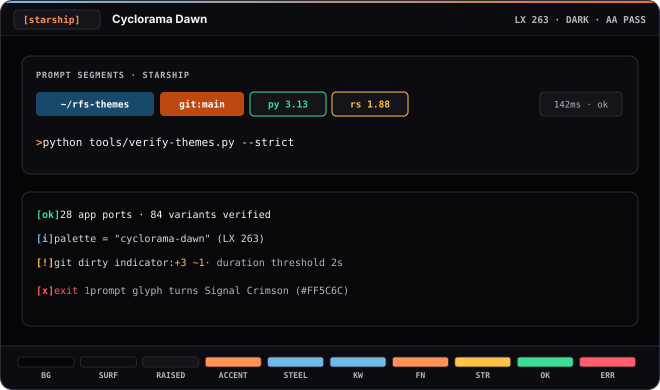
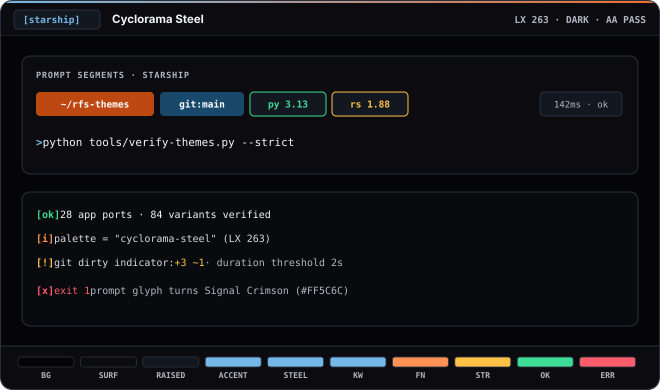
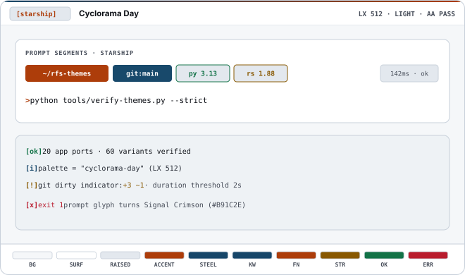

# Cyclorama Dawn for Starship

Three **Cyclorama Dawn v2.1.0 (Steel & Beacon Orange)** themes for **[Starship](https://starship.rs/)**, built from [`Real-Fruit-Snacks/rfs-brand`](https://github.com/Real-Fruit-Snacks/rfs-brand) tokens in [`Real-Fruit-Snacks/rfs-themes`](https://github.com/Real-Fruit-Snacks/rfs-themes). Each drop-in file configures directory, git, Rust, Python, Node.js, duration, and prompt character segments using named `[palettes.cyclorama_*]` tables.

## Install

1. Copy `cyclorama-dawn.toml` (or `steel` / `day`) to `~/.config/starship.toml`.
2. Or append `palettes.toml` to your existing `~/.config/starship.toml` and set `palette = "cyclorama_dawn"` at the top.
3. Start a new shell session to load the updated Starship prompt.

```sh
mkdir -p ~/.config
cp apps/starship/cyclorama-dawn.toml ~/.config/starship.toml
```

## Included Pack Files

- [palettes.toml — All 3 `[palettes.cyclorama_*]` tables](palettes.toml)

## Variants

| Variant | Lighting Cue | Mode | Accent Role | Background | Accent | Secondary | Files |
|---|---|---|---|---|---|---|---|
| **Cyclorama Dawn** | `LX 263` | Dark | Beacon Orange | `#050507` | `#FF9254` | `#74B8E8` | [`cyclorama-dawn.toml`](cyclorama-dawn.toml) |
| **Cyclorama Steel** | `LX 263` | Dark | Steel Blue | `#050507` | `#74B8E8` | `#FF9254` | [`cyclorama-steel.toml`](cyclorama-steel.toml) |
| **Cyclorama Day** | `LX 512` | Light | Alabaster Day | `#F5F7F9` | `#AD3D0A` | `#164669` | [`cyclorama-day.toml`](cyclorama-day.toml) |

### 1. Cyclorama Dawn (`LX 263 Dark · Beacon Orange`)

Matte dark Starship prompt with Steel Blue path pills, Beacon Orange git segments, and Signal Emerald status.



### 2. Cyclorama Steel (`LX 263 Dark · Steel Blue`)

Cool steel-charcoal Starship prompt with Steel Blue primary focus and Beacon Orange secondary highlights.



### 3. Cyclorama Day (`LX 512 Light · Alabaster Day`)

Alabaster Day light Starship prompt with high-contrast Steel pills, burnt Beacon accents, and deep Signal badges.



## Regenerating

```sh
python tools/build_cli.py
```
