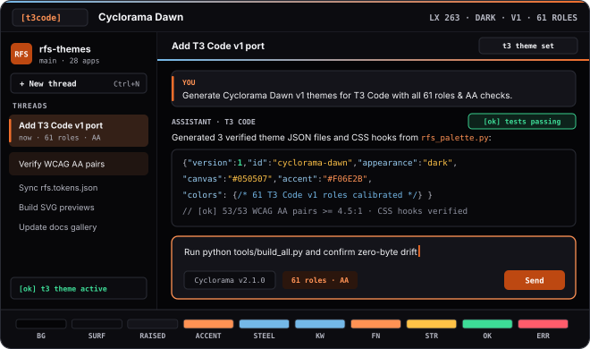
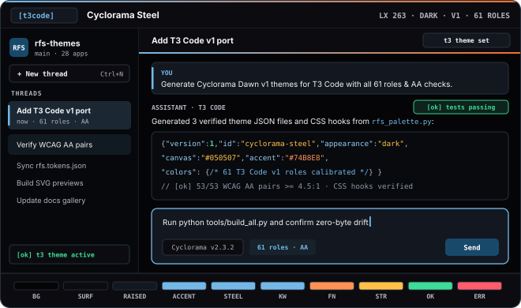
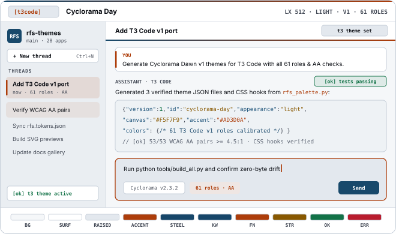

# Cyclorama Dawn for T3 Code

Three **Cyclorama Dawn v2.3.2 (Steel & Beacon Orange)** themes for **[T3 Code](https://github.com/pingdotgg/t3code)**, built from [`Real-Fruit-Snacks/rfs-brand`](https://github.com/Real-Fruit-Snacks/rfs-brand) using T3 Code's v1 theme schema (all **61** official `THEME_COLOR_ROLES` + scoped `THEME_CSS_HOOKS` finishing touches) with every foreground/background contrast pair verified at **>= 4.5:1 WCAG AA**.

- **Category:** Editors & IDEs
- **Format:** `T3 Code Theme JSON + CSS (v1)`
- **Gallery:** [https://real-fruit-snacks.github.io/rfs-themes/](https://real-fruit-snacks.github.io/rfs-themes/)

## Install

### Option 1 — T3 Code CLI (Recommended)

Apply any variant directly with `t3 theme set`:

```sh
t3 theme set apps/t3code/cyclorama-dawn.json
# Switch to Steel Blue or Alabaster Day:
# t3 theme set apps/t3code/cyclorama-steel.json
# t3 theme set apps/t3code/cyclorama-day.json

# Inspect or reset the active theme:
t3 theme show
t3 theme clear
```

### Option 2 — Desktop Settings UI

1. Open **T3 Code** -> **Settings** -> **Themes** -> **Import theme**.
2. Paste the full contents of `cyclorama-dawn.json`, `cyclorama-steel.json`, or `cyclorama-day.json` (or click **Copy** in the web gallery).
3. Alternatively, copy the `cyclorama-*.json` files directly into `~/.t3/userdata/themes/` and select the variant in Settings.

## Variants

| Variant | LX | Appearance | Accent Role | Canvas | Accent | Message Action | File |
|---|---|---|---|---|---|---|---|
| **Cyclorama Dawn** | `LX 263` | `dark` | Beacon Orange | `#050507` | `#F06E2B` | `#BD4811` | [`cyclorama-dawn.json`](cyclorama-dawn.json) |
| **Cyclorama Steel** | `LX 263` | `dark` | Steel Blue | `#050507` | `#74B8E8` | `#18496B` | [`cyclorama-steel.json`](cyclorama-steel.json) |
| **Cyclorama Day** | `LX 512` | `light` | Alabaster Day | `#F5F7F9` | `#AD3D0A` | `#18496B` | [`cyclorama-day.json`](cyclorama-day.json) |

## Previews

### Cyclorama Dawn (`LX 263` · Beacon Orange)

Matte #050507 dark stage with Beacon Orange focus and Steel Blue secondary accents.



### Cyclorama Steel (`LX 263` · Steel Blue)

Cool steel-charcoal dark stage with Steel Blue controls and Beacon Orange highlights.



### Cyclorama Day (`LX 512` · Alabaster Day)

Crisp #F5F7F9 Alabaster Day light workspace with white panels, burnt Beacon links, and Steel buttons.



## Regenerating

```sh
python tools/build_t3code.py
```
