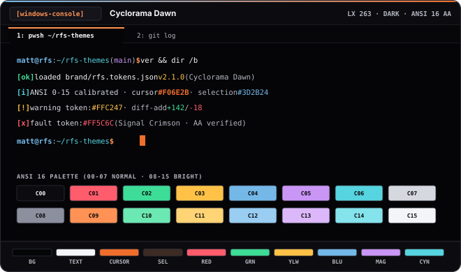
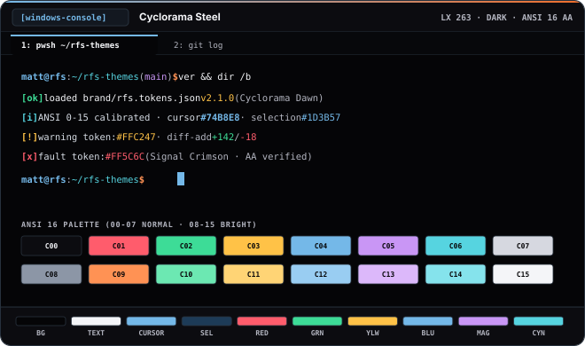
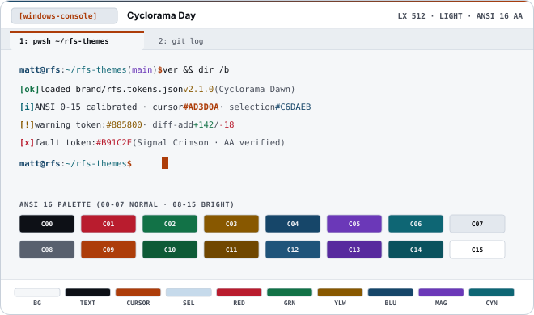

# Cyclorama Dawn for Windows Console Host (`cmd.exe` / `conhost`)

Three **Cyclorama Dawn v2.1.0 (Steel & Beacon Orange)** Windows Registry (`.reg`) themes targeting `HKEY_CURRENT_USER\Console` for **[Windows Console Host](https://learn.microsoft.com/en-us/windows/console/)** (`cmd.exe` / `conhost.exe`), plus a 1-click [`restore-defaults.reg`](restore-defaults.reg) revert file (official Windows 10/11 Campbell defaults), calibrated from [`Real-Fruit-Snacks/rfs-brand`](https://github.com/Real-Fruit-Snacks/rfs-brand).

## Variants

| Variant | Lighting | Mode | Accent Role | Theme File |
|---|---|---|---|---|
| **Cyclorama Dawn** | `LX 263` | `dark` | Beacon Orange | [`cyclorama-dawn.reg`](cyclorama-dawn.reg) |
| **Cyclorama Steel** | `LX 263` | `dark` | Steel Blue | [`cyclorama-steel.reg`](cyclorama-steel.reg) |
| **Cyclorama Day** | `LX 512` | `light` | Alabaster Day | [`cyclorama-day.reg`](cyclorama-day.reg) |

**1-Click Revert:** [`restore-defaults.reg`](restore-defaults.reg) restores official Windows 10/11 Campbell `ColorTable00..15`, `ScreenColors`, and `PopupColors`.

## Install

1. Double-click `cyclorama-dawn.reg` (or `cyclorama-steel.reg` / `cyclorama-day.reg`) and confirm the Registry Editor prompt, or import from the command line:

```cmd
reg import apps\windows-console\cyclorama-dawn.reg
```

2. Open a new `cmd.exe` window — `ScreenColors` (`0x00000007`) pairs slot `00` (background) and slot `07` (foreground), while `PopupColors` sets a high-contrast `F7` command history popup (`>= 18:1`).
3. To revert to stock Windows defaults at any time:

```cmd
reg import apps\windows-console\restore-defaults.reg
```

*(Note: Shortcut-specific `.lnk` files such as pinned Command Prompt shortcuts may store per-shortcut overrides; unpinned `cmd.exe` launches inherit `HKCU\Console` directly.)*

## Previews

### 1. Cyclorama Dawn (`LX 263 Dark · Beacon Orange`)

Matte #050507 dark stage with Beacon Orange focus and Steel Blue secondary accents.



### 2. Cyclorama Steel (`LX 263 Dark · Steel Blue`)

Cool steel-charcoal dark stage with Steel Blue controls and Beacon Orange highlights.



### 3. Cyclorama Day (`LX 512 Light · Alabaster Day`)

Crisp #F5F7F9 Alabaster Day light workspace with white panels, burnt Beacon links, and Steel buttons.



## Windows Console ColorTable Mapping (`dword:00bbggrr`)

Windows Console maps `ColorTable00..15` in legacy VGA bit order (`01=Blue, 04=Red`) rather than ANSI order (`01=Red, 04=Blue`), with little-endian `COLORREF` (`00BBGGRR`) DWORDs:

| Console Slot | Dawn (`COLORREF`) | Steel (`COLORREF`) | Day (`COLORREF`) |
|---|---|---|---|
| `00 Black (Screen BG)` | `#050507` (`dword:00070505`) | `#050507` (`dword:00070505`) | `#F5F7F9` (`dword:00f9f7f5`) |
| `01 DarkBlue` | `#74B8E8` (`dword:00e8b874`) | `#74B8E8` (`dword:00e8b874`) | `#164669` (`dword:00694616`) |
| `02 DarkGreen` | `#3DDC97` (`dword:0097dc3d`) | `#3DDC97` (`dword:0097dc3d`) | `#127247` (`dword:00477212`) |
| `03 DarkCyan` | `#56D4E0` (`dword:00e0d456`) | `#56D4E0` (`dword:00e0d456`) | `#0E6674` (`dword:0074660e`) |
| `04 DarkRed` | `#FF5C6C` (`dword:006c5cff`) | `#FF5C6C` (`dword:006c5cff`) | `#B91C2E` (`dword:002e1cb9`) |
| `05 DarkMagenta` | `#C996F5` (`dword:00f596c9`) | `#C996F5` (`dword:00f596c9`) | `#6B38B8` (`dword:00b8386b`) |
| `06 DarkYellow` | `#FFC247` (`dword:0047c2ff`) | `#FFC247` (`dword:0047c2ff`) | `#885800` (`dword:00005888`) |
| `07 Gray (Screen FG)` | `#F4F5F8` (`dword:00f8f5f4`) | `#F4F5F8` (`dword:00f8f5f4`) | `#0D1016` (`dword:0016100d`) |
| `08 DarkGray` | `#8C8F9D` (`dword:009d8f8c`) | `#8C96A6` (`dword:00a6968c`) | `#58606E` (`dword:006e6058`) |
| `09 Blue` | `#99CDF2` (`dword:00f2cd99`) | `#99CDF2` (`dword:00f2cd99`) | `#1F547A` (`dword:007a541f`) |
| `10 Green` | `#6CE8B2` (`dword:00b2e86c`) | `#6CE8B2` (`dword:00b2e86c`) | `#0D5A37` (`dword:00375a0d`) |
| `11 Cyan` | `#85E3EC` (`dword:00ece385`) | `#85E3EC` (`dword:00ece385`) | `#0A525E` (`dword:005e520a`) |
| `12 Red (Beacon)` | `#FF9254` (`dword:005492ff`) | `#FF9254` (`dword:005492ff`) | `#AD3D0A` (`dword:000a3dad`) |
| `13 Magenta` | `#DCB8FA` (`dword:00fab8dc`) | `#DCB8FA` (`dword:00fab8dc`) | `#572A9E` (`dword:009e2a57`) |
| `14 Yellow` | `#FFD475` (`dword:0075d4ff`) | `#FFD475` (`dword:0075d4ff`) | `#704700` (`dword:00004770`) |
| `15 White` | `#F4F5F8` (`dword:00f8f5f4`) | `#F4F5F8` (`dword:00f8f5f4`) | `#FFFFFF` (`dword:00ffffff`) |

## Regenerating

```sh
python tools/build_extras_shells.py
```

Browse all ports in the [Cyclorama Dawn Theme Gallery](https://real-fruit-snacks.github.io/rfs-themes/) or on [GitHub](https://github.com/Real-Fruit-Snacks/rfs-themes).
