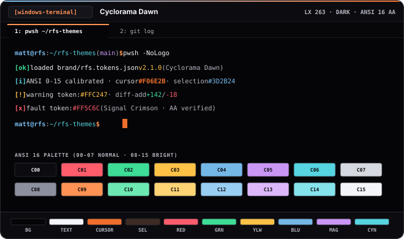
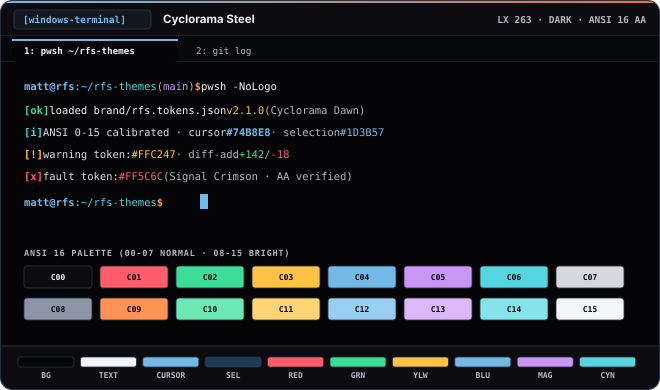
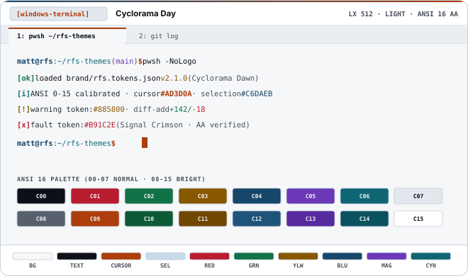

# Cyclorama Dawn for Windows Terminal & PowerShell

Three **Cyclorama Dawn v2.1.0 (Steel & Beacon Orange)** color schemes for **[Windows Terminal](https://learn.microsoft.com/en-us/windows/terminal/)** plus matching **PowerShell PSReadLine** syntax highlighting scripts, built from [`Real-Fruit-Snacks/rfs-brand`](https://github.com/Real-Fruit-Snacks/rfs-brand).

## Variants

| Variant | Lighting | Mode | Accent Role | Theme File | PSReadLine |
|---|---|---|---|---|---|
| **Cyclorama Dawn** | `LX 263` | `dark` | Beacon Orange | [`cyclorama-dawn.json`](cyclorama-dawn.json) | [`psreadline/cyclorama-dawn.ps1`](psreadline/cyclorama-dawn.ps1) |
| **Cyclorama Steel** | `LX 263` | `dark` | Steel Blue | [`cyclorama-steel.json`](cyclorama-steel.json) | [`psreadline/cyclorama-steel.ps1`](psreadline/cyclorama-steel.ps1) |
| **Cyclorama Day** | `LX 512` | `light` | Alabaster Day | [`cyclorama-day.json`](cyclorama-day.json) | [`psreadline/cyclorama-day.ps1`](psreadline/cyclorama-day.ps1) |

All three schemes are also bundled together in [`schemes.json`](schemes.json).

## Install

1. Open Windows Terminal **Settings** (`Ctrl+,`) and click **Open JSON file** to edit `settings.json`.
2. Add the desired scheme object from `cyclorama-dawn.json` (or all three from `schemes.json`) into the `"schemes": [ ... ]` array, then activate it under `"profiles": { "defaults": { "colorScheme": "Cyclorama Dawn" } }`.
3. Optional: add matching PowerShell syntax coloring (requires PSReadLine 2.2+ / PowerShell 7+) by dot-sourcing the matching `.ps1` file in your `$PROFILE`:

```powershell
. "$HOME\rfs-themes\apps\windows-terminal\psreadline\cyclorama-dawn.ps1"
```

## Previews

### 1. Cyclorama Dawn (`LX 263 Dark · Beacon Orange`)

Matte #050507 dark stage with Beacon Orange focus and Steel Blue secondary accents.



### 2. Cyclorama Steel (`LX 263 Dark · Steel Blue`)

Cool steel-charcoal dark stage with Steel Blue controls and Beacon Orange highlights.



### 3. Cyclorama Day (`LX 512 Light · Alabaster Day`)

Crisp #F5F7F9 Alabaster Day light workspace with white panels, burnt Beacon links, and Steel buttons.



## Palette Mapping

| Role | Cyclorama Dawn (`LX 263`) | Cyclorama Steel (`LX 263`) | Cyclorama Day (`LX 512`) |
|---|---|---|---|
| Background / Foreground | `#050507` / `#F4F5F8` | `#050507` / `#F4F5F8` | `#F5F7F9` / `#0D1016` |
| Cursor / Cursor Text | `#F06E2B` / `#050507` | `#74B8E8` / `#050507` | `#AD3D0A` / `#FFFFFF` |
| Selection Background | `#3D2B24` | `#1D3B57` | `#C6DAEB` |
| Accent / Secondary | `#FF9254` / `#74B8E8` | `#74B8E8` / `#FF9254` | `#AD3D0A` / `#164669` |
| ANSI Red / Green / Yellow | `#FF5C6C` / `#3DDC97` / `#FFC247` | `#FF5C6C` / `#3DDC97` / `#FFC247` | `#B91C2E` / `#127247` / `#885800` |
| ANSI Blue / Magenta / Cyan | `#74B8E8` / `#C996F5` / `#56D4E0` | `#74B8E8` / `#C996F5` / `#56D4E0` | `#164669` / `#6B38B8` / `#0E6674` |

## Regenerating

```sh
python tools/build_terminals.py
```
