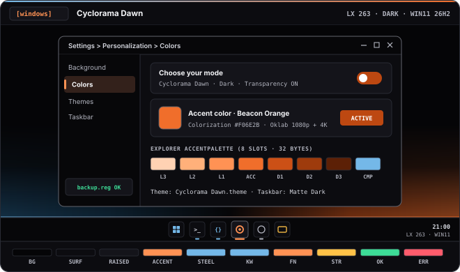
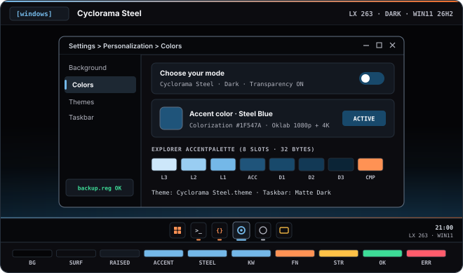
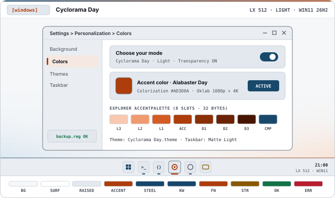

# Cyclorama Dawn for Windows 11

Native Windows 11 `.theme` packs, pure-Oklab 1080p & 4K wallpapers (zero 8-bit banding via 4×4 Bayer dithering), and backup-first PowerShell installers calibrated from [`brand/rfs.tokens.json`](../../brand/rfs.tokens.json) (**Cyclorama Dawn v2.3.2**) for **[Windows 11](https://www.microsoft.com/windows/)** (`Windows 11 .theme + Wallpapers + .ps1`).

## Install

1. Run `.\install-cyclorama-dawn.ps1` (or `steel` / `day`) from `apps/windows/` — it auto-detects `1080p` vs `4k` (`-Resolution auto|1080p|4k`), saves a one-time registry backup to `%LOCALAPPDATA%\rfs-themes\windows\backup-pre-rfs.reg`, installs wallpapers & `.theme` files, sets the 32-byte `AccentPalette`, and refreshes Windows live.
2. Pass `-TintTaskbar` if you want Start/Taskbar tinted with the accent color (off by default so the taskbar stays matte `#050507` or Alabaster `#F5F7F9`).
3. Switch between **Cyclorama Dawn**, **Cyclorama Steel**, and **Cyclorama Day** anytime from **Settings -> Personalization -> Themes**, or double-click `backup-pre-rfs.reg` to revert.

### Quick PowerShell Install

```powershell
# Auto-detects 4K (>1920x1080 across all monitors: 1440p/ultrawide/4K) vs 1080p and backs up current settings to backup-pre-rfs.reg
.\install-cyclorama-dawn.ps1

# Optional: force 4K or enable taskbar accent tinting
.\install-cyclorama-steel.ps1 -Resolution 4k -TintTaskbar
```

### Reverting

Double-click `%LOCALAPPDATA%\rfs-themes\windows\backup-pre-rfs.reg` (created automatically on first run) or choose any prior theme under **Settings -> Personalization -> Themes**.

## Included Files

| Artifact | Path |
|---|---|
| Cyclorama Dawn Theme (Cyclorama Dawn.theme) | [`Cyclorama Dawn.theme`](Cyclorama%20Dawn.theme) |
| Cyclorama Steel Theme (Cyclorama Steel.theme) | [`Cyclorama Steel.theme`](Cyclorama%20Steel.theme) |
| Cyclorama Day Theme (Cyclorama Day.theme) | [`Cyclorama Day.theme`](Cyclorama%20Day.theme) |
| Cyclorama Dawn Installer (install-cyclorama-dawn.ps1) | [`install-cyclorama-dawn.ps1`](install-cyclorama-dawn.ps1) |
| Cyclorama Steel Installer (install-cyclorama-steel.ps1) | [`install-cyclorama-steel.ps1`](install-cyclorama-steel.ps1) |
| Cyclorama Day Installer (install-cyclorama-day.ps1) | [`install-cyclorama-day.ps1`](install-cyclorama-day.ps1) |
| Cyclorama Dawn Wallpaper 1080p | [`wallpapers/cyclorama-dawn-1080p.png`](wallpapers/cyclorama-dawn-1080p.png) |
| Cyclorama Dawn Wallpaper 4K | [`wallpapers/cyclorama-dawn-4k.png`](wallpapers/cyclorama-dawn-4k.png) |
| Cyclorama Steel Wallpaper 1080p | [`wallpapers/cyclorama-steel-1080p.png`](wallpapers/cyclorama-steel-1080p.png) |
| Cyclorama Steel Wallpaper 4K | [`wallpapers/cyclorama-steel-4k.png`](wallpapers/cyclorama-steel-4k.png) |
| Cyclorama Day Wallpaper 1080p | [`wallpapers/cyclorama-day-1080p.png`](wallpapers/cyclorama-day-1080p.png) |
| Cyclorama Day Wallpaper 4K | [`wallpapers/cyclorama-day-4k.png`](wallpapers/cyclorama-day-4k.png) |

## Variants

| Variant | Lighting Cue | Mode | Colorization (`ARGB`) | DWM Accent (`ABGR`) | Background | Wallpapers |
|---|---|---|---|---|---|---|
| **Cyclorama Dawn** | `LX 263` | `dark` | `0xC4F06E2B` | `0xFF2B6EF0` | `#050507` | [1080p](wallpapers/cyclorama-dawn-1080p.png) · [4K](wallpapers/cyclorama-dawn-4k.png) |
| **Cyclorama Steel** | `LX 263` | `dark` | `0xC41F547A` | `0xFF7A541F` | `#050507` | [1080p](wallpapers/cyclorama-steel-1080p.png) · [4K](wallpapers/cyclorama-steel-4k.png) |
| **Cyclorama Day** | `LX 512` | `light` | `0xC4AD3D0A` | `0xFF0A3DAD` | `#F5F7F9` | [1080p](wallpapers/cyclorama-day-1080p.png) · [4K](wallpapers/cyclorama-day-4k.png) |

## 8-Slot Windows 11 `AccentPalette`

| Variant | Light3 | Light2 | Light1 | Accent | Dark1 | Dark2 | Dark3 | Complementary |
|---|---|---|---|---|---|---|---|---|
| **Cyclorama Dawn** | `#FFD2B3` | `#FFB07A` | `#FF9254` | `#F06E2B` | `#CC5016` | `#9E3B0C` | `#5C2006` | `#74B8E8` |
| **Cyclorama Steel** | `#CDE7FA` | `#99CDF2` | `#74B8E8` | `#1F547A` | `#18496B` | `#123955` | `#0B2436` | `#FF9254` |
| **Cyclorama Day** | `#F8C9B0` | `#F09B6E` | `#D45B24` | `#AD3D0A` | `#8B2F06` | `#6A2304` | `#471602` | `#18496B` |

## Previews

### 1. Cyclorama Dawn (`LX 263 · Beacon Orange`)

Matte #050507 Windows 11 dark stage with Oklab Steel-to-Beacon floor wash, Beacon Orange (#F06E2B) DWM accent, and 8-slot Explorer AccentPalette.



### 2. Cyclorama Steel (`LX 263 · Steel Blue`)

Deep Glacial Steel Windows 11 dark desktop with Oklab Steel wash, #1F547A DWM colorization, and luminous #74B8E8 accent highlights.



### 3. Cyclorama Day (`LX 512 · Alabaster Day`)

Crisp #F5F7F9 Alabaster Day Windows 11 light desktop with subtle frost Steel-to-Dawn floor wash and burnt Beacon (#AD3D0A) accents.



## Regenerating

```sh
python tools/build_windows.py
```

Browse all ports in the [Cyclorama Dawn Theme Gallery](https://real-fruit-snacks.github.io/rfs-themes/) or on [GitHub](https://github.com/Real-Fruit-Snacks/rfs-themes).
