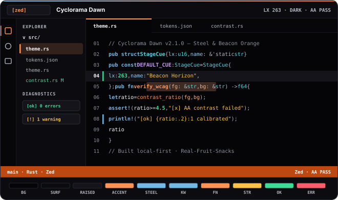
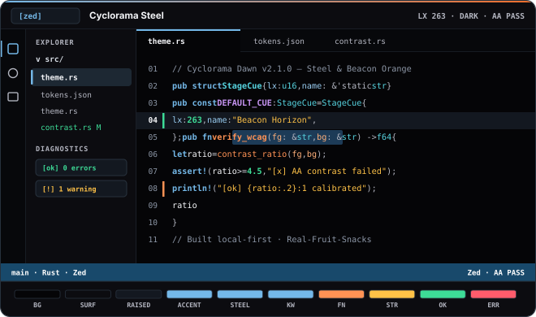
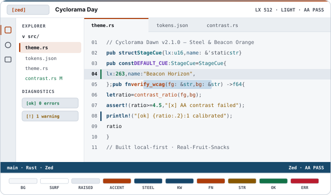

# Cyclorama Dawn for Zed

Three **Cyclorama Dawn v2.1.0 (Steel & Beacon Orange)** themes for **[Zed](https://zed.dev/)**, built from [`Real-Fruit-Snacks/rfs-brand`](https://github.com/Real-Fruit-Snacks/rfs-brand) with WCAG AA calibrated surfaces, syntax tokens, and ANSI 0-15 terminal colors.

- **Category:** Editors & IDEs
- **Format:** `Zed JSON Theme (v0.2.0)`
- **Gallery:** [https://real-fruit-snacks.github.io/rfs-themes/](https://real-fruit-snacks.github.io/rfs-themes/)

## Install

1. Copy `apps/zed/themes/cyclorama.json` into `~/.config/zed/themes/` (or `%APPDATA%\Zed\themes\` on Windows) for all three variants in one pack, or copy an individual `cyclorama-*.json` file.
2. Open Zed's theme selector (`Ctrl+K Ctrl+T` / `Cmd+K Cmd+T`) and pick **Cyclorama Dawn**, **Cyclorama Steel**, or **Cyclorama Day**.
3. Optional: set `theme.dark` and `theme.light` in `~/.config/zed/settings.json` to follow your OS dark/light mode.

Drop [`themes/cyclorama.json`](themes/cyclorama.json) into `~/.config/zed/themes/` to install all three variants at once, or use the individual variant files below.

## Variants

| Variant | LX | Mode | Accent Role | Background | Accent | Secondary | File |
|---|---|---|---|---|---|---|---|
| **Cyclorama Dawn** | `LX 263` | `dark` | Beacon Orange | `#050507` | `#FF9254` | `#74B8E8` | [`themes/cyclorama-dawn.json`](themes/cyclorama-dawn.json) |
| **Cyclorama Steel** | `LX 263` | `dark` | Steel Blue | `#050507` | `#74B8E8` | `#FF9254` | [`themes/cyclorama-steel.json`](themes/cyclorama-steel.json) |
| **Cyclorama Day** | `LX 512` | `light` | Alabaster Day | `#F5F7F9` | `#AD3D0A` | `#164669` | [`themes/cyclorama-day.json`](themes/cyclorama-day.json) |

## Previews

### Cyclorama Dawn (`LX 263` · Beacon Orange)

Matte #050507 dark stage with Beacon Orange focus and Steel Blue secondary accents.



### Cyclorama Steel (`LX 263` · Steel Blue)

Cool steel-charcoal dark stage with Steel Blue controls and Beacon Orange highlights.



### Cyclorama Day (`LX 512` · Alabaster Day)

Crisp #F5F7F9 Alabaster Day light workspace with white panels, burnt Beacon links, and Steel buttons.



## Regenerating

```sh
python tools/build_editors.py
```
